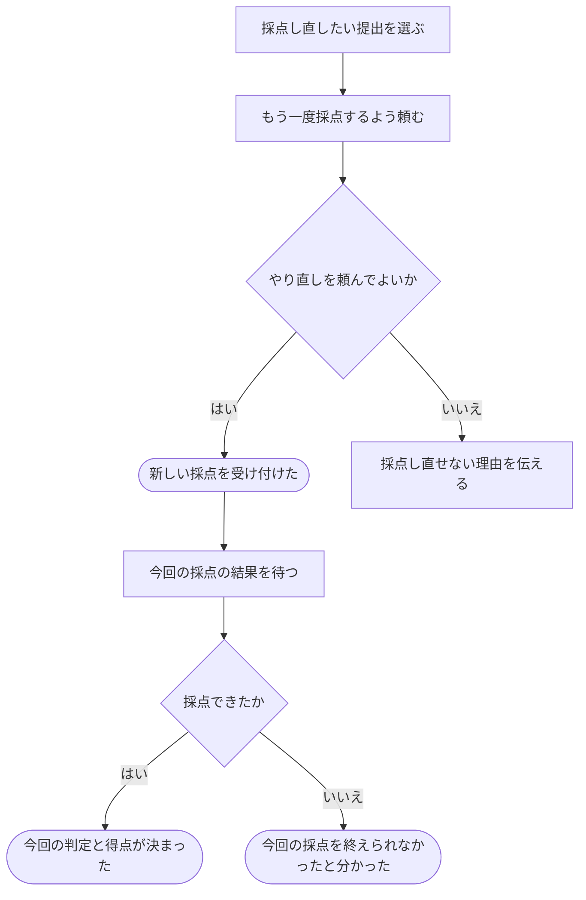

# 前の提出をもう一度採点してもらう

[シナリオの一覧へ](../../mutation-scenarios.md)

## したいこと

問題の管理担当・テスト担当、またはその問題を含む通常大会の運営担当が、すでにある提出について、もう一度採点を頼む。前の採点と今回の採点を区別して結果を確認する。

## 誰が、誰に、何をしてよいか

| 操作 | 誰が | 誰に／何に・範囲 |
| --- | --- | --- |
| 提出を採点し直す（S2-01） | 問題Pの problem-owner / tester、またはPを含む通常大会Cの contest-setter | その問題Pに対する提出。提出した本人である必要はない |

根拠は[ロール定義](../../../domain/role.md)。書かれていない役割の許可は補わない。全操作の対応は[許可条件の一覧](../../permission-operations.md)を参照する。

## 始める前

本人がログインし、対象提出の問題の `problem-owner` / `tester`、またはその問題を含む通常大会の `contest-setter` を持つこと。対象は他の人の提出でもよい。提出した本人であることだけでは、やり直しを頼む許可にならない。

## 流れ

## できたと言えること

- 同じ提出について、前の採点と今回の採点を区別できる。
- 今回の採点でも、完了したテストケース数を途中表示し、不正解や時間切れで残りを打ち切らない。前の採点から届いた途中経過を混ぜない。
- 同じ依頼の送り直しと、新しく採点を頼むことを区別する。
- 自分に認められた提出についてだけ、採点のやり直しを頼める。

## まだ決めること

- 前の問題内容と新しい問題内容の、どちらで採点し直すか。
- 採点し直している間にどの結果を見せるか、古い採点が遅れて終わった場合にどう扱うか。

## つながる話

- [進み具合を見ながら結果を待つ](watch-judging.md)

- [解答を提出して採点してもらう](submit-answer.md)
- [まとめて採点し直してもらう](judge-many-again.md)
