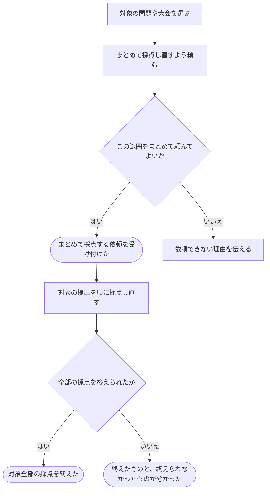

# まとめて採点し直してもらう

[シナリオの一覧へ](../../mutation-scenarios.md)

## したいこと

採点をやり直せる立場の人が、ある問題や大会の提出をまとめて選び、一括で採点し直すよう頼む。全部を終えるまで待たずに、依頼を受け付けたことと、その後の進み具合を確認する。

## 始める前

対象となる問題や大会があり、自分がその範囲の採点し直しを頼めること。

## 流れ

## できたと言えること

- 依頼した範囲と、どの提出を採点し直しているかを区別できる。
- 依頼を受け付けた段階と、全部を終えた段階を区別できる。
- 一部を採点できなかった場合に、全部終わったように案内しない。

## まだ決めること

- 依頼した後に増えた提出も、今回の対象に含めるか。
- 一部だけ採点できなかったときに、どの範囲をもう一度頼めるか。
- 進み具合をどう知らせるか、同じ依頼が繰り返し届いた場合にどう扱うか。

## つながる話

- [前の提出をもう一度採点してもらう](judge-again.md)
- [大会を用意し、予定やルールを決める](../contests/organize-contest.md)
