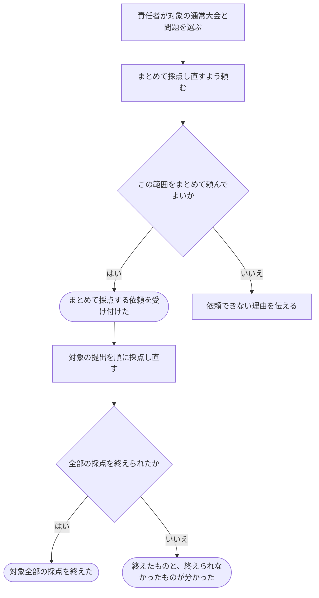

# まとめて採点し直してもらう

[シナリオの一覧へ](../../mutation-scenarios.md)

## したいこと

通常の大会の責任者が、その大会の各問題への提出をまとめて選び、一括で採点し直すよう頼む。問題単位で全提出を一括処理する場合の許可は未決として分ける。全部を終えるまで待たずに、依頼を受け付けたことと、その後の進み具合を確認する。

## 誰が、誰に、何をしてよいか

| 操作 | 誰が | 誰に／何に・範囲 |
| --- | --- | --- |
| 通常の大会の提出を問題ごとに一括で採点し直す（S3-01） | 通常大会Cの contest-admin | 大会Cの各問題に対する、大会Cの提出 |
| 問題単位で全提出を一括で採点し直す（S3-02） | 未決。problem-owner / tester の rejudge が一括操作も含むか確認が必要 | 問題Pに対する全提出 |

根拠は[ロール定義](../../../domain/role.md)。書かれていない役割の許可は補わない。全操作の対応は[許可条件の一覧](../../permission-operations.md)を参照する。

## 始める前

本人がログインし、対象の通常大会の `contest-admin` を持つこと。大会の運営担当や問題のテスト担当であるという理由だけで、大会全体の一括採点を許可しない。

## 流れ

## できたと言えること

- 依頼した範囲と、どの提出を採点し直しているかを区別できる。
- 依頼を受け付けた段階と、全部を終えた段階を区別できる。
- 一部を採点できなかった場合に、全部終わったように案内しない。
- 個々の提出では完了したテストケース数を数え、不正解や時間切れでも残りをすべて実行する。一括依頼の「完了した提出数」とは分けて表示する。

## まだ決めること

- 問題単位の全提出への一括処理を、problem-owner / tester の採点し直しの許可に含めるか。
- バーチャル大会の一括採点し直しを誰に許可するか。
- 依頼した後に増えた提出も、今回の対象に含めるか。
- 一部だけ採点できなかったときに、どの範囲をもう一度頼めるか。
- 一括依頼の提出単位の進捗と、各提出のケース単位の進捗を誰にどこまで見せるか。通常提出と一括再採点の混雑時の扱い。
- 進み具合をどう知らせるか、同じ依頼が繰り返し届いた場合にどう扱うか。

## つながる話

- [進み具合を見ながら結果を待つ](watch-judging.md)

- [前の提出をもう一度採点してもらう](judge-again.md)
- [大会を用意し、予定やルールを決める](../contests/organize-contest.md)
