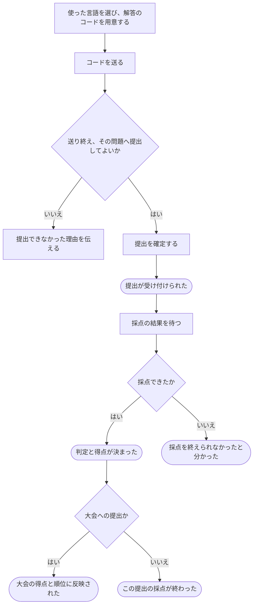

# 解答を提出して採点してもらう

[シナリオの一覧へ](../../mutation-scenarios.md)

## したいこと

問題を解いた人が、使ったプログラミング言語を選び、自分のコードを提出する。提出が受け付けられたことを確かめたうえで、採点の結果を待つ。

## 始める前

自分の名前でログインし、その問題へ提出できること。問題の内容と使える言語が決まっていること。大会中の提出なら、その大会に参加し、提出できる時間になっていること。

## 流れ

## できたと言えること

- コードの送信途中と、提出を受け付けた後を区別できる。
- 受付時に決めた問題の内容で採点し、後の問題変更に影響されない。
- どの提出の結果なのかが分かり、同じ結果が繰り返し届いても得点を二重に加えない。
- 不正解になった場合と、採点そのものを終えられなかった場合を区別できる。

## まだ決めること

- 送信途中で画面を閉じたときや、同じ提出操作をもう一度送った場合の扱い。
- 結果が決まったことを利用者へどう知らせるか。
- 大会の得点・順位に、いつまでに反映したと伝えるか。

## つながる話

- [ログインして、使い終わったらログアウトする](../authentication/sign-in-and-out.md)
- [大会に参加する](../permissions/join-contest.md)
- [前の提出をもう一度採点してもらう](judge-again.md)
- [解説を書き、直す・取り下げる](../others/write-editorial.md)
