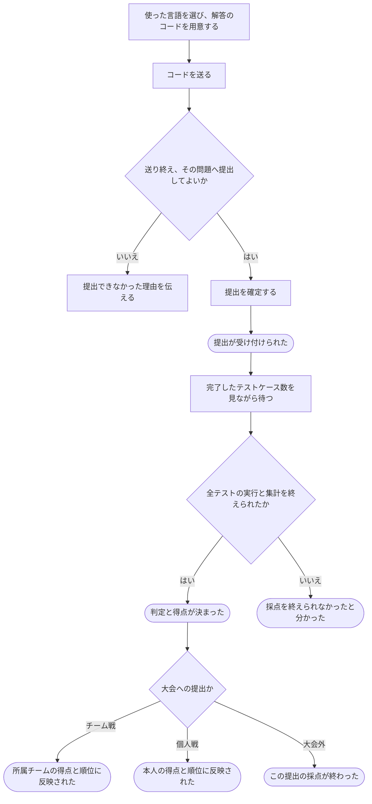

# 解答を提出して採点してもらう

[シナリオの一覧へ](../../mutation-scenarios.md)

## したいこと

問題を解いた人が、使ったプログラミング言語を選び、自分のコードを提出する。提出が受け付けられたことを確かめたうえで、完了したテストケース数を見ながら、採点の結果を待つ。不正解や時間切れがあっても残りのケースをすべて実行する。

## 誰が、誰に、何をしてよいか

| 操作 | 誰が | 誰に／何に・範囲 |
| --- | --- | --- |
| 大会とは別に解答を提出する（S1-01） | 基本的な利用資格を持つ人（standard-user） | 公開された問題Pに、自分の解答を提出 |
| 通常の大会に解答を提出する（S1-02） | 通常大会Cの contestant | その大会Cに含まれる問題Pに、自分の解答を提出。Cの開催時間中に限る。チーム戦では提出者本人を記録し、所属チームの得点として集計する |
| バーチャル大会に解答を提出する（S1-03） | バーチャル大会Vの virtual-contestant | その大会Vに含まれる問題Pに、自分の解答を提出。Vの開催時間中に限る |

根拠は[ロール定義](../../../domain/role.md)。書かれていない役割の許可は補わない。全操作の対応は[許可条件の一覧](../../permission-operations.md)を参照する。

## 始める前

本人がログインし、通常の提出では `standard-user` を持ち、問題が公開されていること。大会への提出では対象大会の `contestant` または `virtual-contestant` を持ち、その大会内の問題で、開催時間中であること。チーム戦の通常大会ではteamIdを指定せず、APIが本人の所属チームを提出に記録する。問題の内容と使える言語が決まっていること。

## 流れ

1. `POST /api/v1/submissions/uploads` に問題ID、言語ID、提出先の文脈、ファイル一覧を送り、アップロード先を受け取る。通常大会のチーム戦でもteamIdは送らない。
2. 返された署名付きURLを使って、ソースをS3へ直接アップロードする。
3. `POST /api/v1/submissions` にuploadIdを送り、提出を確定する。APIはログイン中のuserIdを記録し、チーム戦なら受理時点の所属からteamIdを決める。受付応答にはsubmissionId、judgeRunId、problemVersionId、acceptedAtが入り、チーム戦ではteamIdも返す。
4. `GET /api/v1/submissions/{submissionId}` と `GET /api/v1/submissions/{submissionId}/judge-runs/{judgeRunId}` で提出情報と採点結果を確認する。
5. チーム戦では `GET /api/v1/contests/{contestId}/teams/{teamId}/submissions` で自分のチームの提出一覧を取得する。各項目のuserIdで提出者を区別し、currentJudgeRunIdから現在の採点を特定する。同じチームのメンバーは各提出の詳細・採点履歴・採点結果も取得できる。
6. チーム戦の順位は `GET /api/v1/contests/{contestId}/standings/team` で取得する。チームメンバーの全提出を集約し、各問題の最高得点の合計とタイブレーク値を返す。
7. `GET /api/v1/submissions/{submissionId}/source` で提出ソースのダウンロード先を取得する。提出者本人はいつでも、チーム戦では同じチームのメンバーも取得できる。通常大会・バーチャル大会では、終了時刻の到達後は未ログイン利用者を含め誰でも取得できる。応答にはS3からファイルごとに直接取得する署名付きURLと有効期限が含まれる。

## できたと言えること

- 自分自身の解答として提出し、他の人の名前で提出しない。チーム戦では提出者のuserIdとチームのteamIdを記録する。
- 問題を管理・編集できるという理由だけでは、非公開問題への大会外の提出を許可しない。その許可は未決。
- コードの送信途中と、提出を受け付けた後を区別できる。
- ジャッジ中にも、完了したテストケース数が順次更新される。ケース番号や正解した件数と混同しない。
- 途中のケースが不正解や時間切れでも、残りをすべて実行する。コンパイル不能や基盤障害の扱いは別に具体化する。
- 受付時に決めた問題の内容で採点し、後の問題変更に影響されない。
- どの提出の結果なのかが分かり、同じ結果が繰り返し届いても得点を二重に加えない。
- 不正解になった場合と、採点そのものを終えられなかった場合を区別できる。

## まだ決めること

- 送信途中で画面を閉じたときや、同じ提出操作をもう一度送った場合の扱い。
- 管理担当・テスト担当が非公開問題に試しに提出するための許可。
- 途中経過と確定結果を利用者へ届ける方法と、更新の遅れの上限。総数やケースごとの判定も表示するか。
- 大会の得点・順位に、いつまでに反映したと伝えるか。

## つながる話

- [提出したあと、進み具合を見ながら結果を待つ](watch-judging.md)

- [ログインして、使い終わったらログアウトする](../authentication/sign-in-and-out.md)
- [大会に参加する](../permissions/join-contest.md)
- [前の提出をもう一度採点してもらう](judge-again.md)
- [解説を書き、直す・取り下げる](../others/write-editorial.md)
