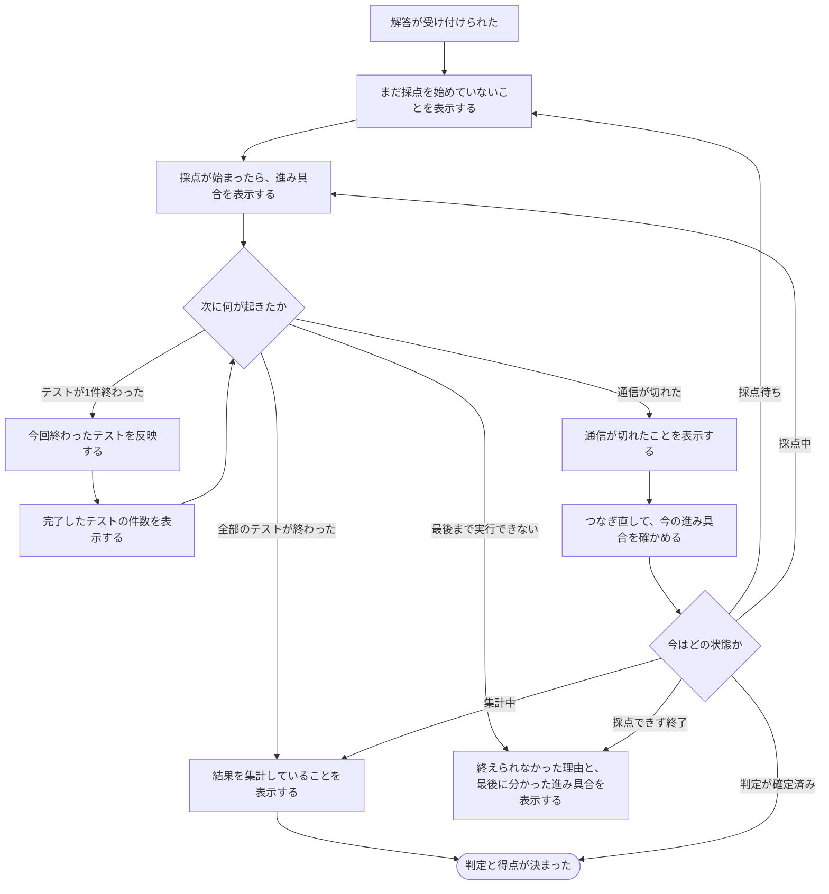

# 提出したあと、進み具合を見ながら結果を待つ

[シナリオの一覧へ](../../mutation-scenarios.md)

## したいこと

解答を提出した人が、受け付けられたことを確認し、採点がどこまで進んだかを見ながら待つ。テストが終わるたびに進み具合が更新され、最後に判定と得点が分かるようにしたい。

確定した要望は、ジャッジ中に完了したテストケース数を見せることと、不正解や時間切れがあっても残りのケースをすべて実行すること。表示する数は、実行中のケース番号や正解した件数ではない。総数を添えて「1/3」のように見せるか、各ケースの判定も見せるかは別に決める。

## 誰が、誰の何を見てよいか

| 確かめること | このシナリオでの範囲 |
| --- | --- |
| 誰が | ログインしている提出者本人 |
| 誰の何を | 自分の提出について、今回の採点の進み具合と結果 |
| 何を見せるか | ジャッジ中の完了したテストケース数。待機・採点中・集計中・終了の見せ方も具体化する |
| 別に決めること | 各テストの判定・名前・入出力・実行時間等をどこまで見せるか。他の人の提出の進捗を誰に見せるか |

[ロール定義](../../../domain/role.md)にある大会運営者の提出閲覧とは分ける。本人が提出できることだけを根拠に、非公開テストの名前や内容まで見せない。

## 始める前

自分の提出が受け付けられ、どの提出のどの採点を待っているかが分かっていること。画面に表示してよい情報の範囲が決まっていること。

## 流れ

不正解や時間切れの判定でも、そのテストは完了として数え、残りもすべて実行する。コンパイルできない場合や実行基盤が故障した場合の終了・復旧は別に決め、不正解を理由とする打ち切りと混同しない。

## いつ、何を見せるか

テストが3件ある場合の例。正解した数ではなく、判定を得られたテストの数を数える。「1/3」のような総数の併記は任意の表示案であり、ここでは「完了1件」と記す。

| 起きたこと | 見せたい内容 | 誤解させないこと |
| --- | --- | --- |
| 提出を受け付けた | 採点待ち | 受け付けたことと、実行を始めたことを区別する |
| 採点が始まった | 採点中・完了0件 | 総数を併記する場合、未確定なら0/0とは表示しない |
| 2番のテストが最初に終わった | 採点中・完了1件 | 「2件完了」にはしない。ケースの番号と、終わった件数は別 |
| 1番のテストも終わった | 採点中・完了2件 | 不正解だったテストも完了に含め、3番のテストを続ける |
| 同じ完了のお知らせがもう一度届いた | 採点中・完了2件のまま | 3件に増やさない |
| 全テストが終わり、得点を計算している | 完了3件・結果を集計中 | 件数がそろっただけでは、最終判定や得点はまだ確定していない |
| 判定・得点が確定した | 最終判定と得点 | 大会の順位への反映まで済んだかは別に分かるようにする |
| 準備中にコンパイルエラーが確定した | コンパイルエラー・採点終了 | すべてのテストを実行したように3件へ増やさない |
| 途中で実行基盤の障害が分かった | 採点を終えられなかったこと | 不正解扱いにせず、進捗が止まったまま待たせ続けない |
| 表示用の通信だけが切れた | 接続が切れていることと、最後に確認した内容 | 採点自体が失敗したとは決め付けない |

## できたと言えること

完了数の表示と全ケースの継続実行を確認する。表示範囲や更新の遅れの上限は、未決事項も合わせて具体化する。

- 最終結果を待つ間にも、終わったテストが順次、完了した件数に反映される。
- 不正解・実行時間超過などの判定でも残りのテストを実行し、全テストの結果を使って最終結果を決める。
- 同じ採点では、同じテストを重ねて数えず、古いお知らせで件数や状態を巻き戻さない。
- ページを読み直したり、別の画面から戻ったりしても、今の進み具合と確定済みの結果を確認できる。
- 画面を閉じても、受け付けた採点は続く。閲覧をやめる操作を、採点の取り消しとして扱わない。
- 再採点を始めた場合は、前の採点の結果と今回の進捗を区別する。前の採点から遅れて届いた知らせを混ぜない。
- 表示が更新されない場合に、通信が切れたのか、採点中なのか、障害が確定したのかを、分かる範囲で区別する。

## まだ決めること

- 総数や各テストの判定も見せるか。「1件終わるたび」を全件画面に描画する意味にするか、最新の件数へまとめて追い付けばよいか。
- テストが終わってから画面へ反映するまで、何秒までの遅れを許すか。混雑時にも同じ条件を求めるか。
- 何をもって1件の判定完了とするか。総数を添える場合の分母と、テスト単位で数えられない問題の見せ方。
- 本人・大会の運営者・一般の閲覧者それぞれに見せてよい途中情報と、閲覧中に権限が変わった場合の扱い。
- 長時間待っているときの案内、実行が止まったと判断する条件、利用者が採点を取り消せるか。

## つながる話

- [解答を提出して採点してもらう](submit-answer.md)
- [前の提出をもう一度採点してもらう](judge-again.md)
- [まとめて採点し直してもらう](judge-many-again.md)
- [表示の要望から、API・実行基盤の条件を整理する](../../submission-progress-constraints.md)
