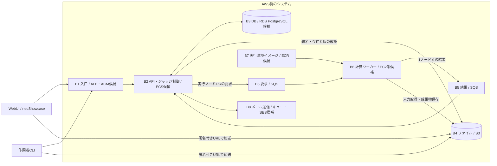

# AWS 側の構成ブロックと議論の境界

2026-10-18。API サーバーとインフラを合わせた AWS 側のシステムを対象とする設計案。先に構成ブロックと接続契約を決め、実装作業を分担する。従来の「API 担当／インフラ担当」を設計境界にしない。

確定事項は、WebUI を neoShowcase、バックエンドを AWS に置くこと、ファイルを S3、ジャッジ要求・結果を SQS に置くこと、PostgreSQL 互換を優先すること。DAG の解決・実行制御は API 側、実行環境周りはインフラ側という既存の担当意図は維持する。

B2 から B5 を介して B6 へ渡す処理の単位は、DAG の実行ノード1つずつとする。この単位は確定事項であり、以下の AWS サービス候補の選定とは分けて扱う。

ALB・ECS・RDS・EC2・ECR・SES は、分離して議論するための具体的な候補であり、採用決定ではない。構成ブロックと AWS リソースは、必要な入出力を保ちながら選定する。

## 構成案

B0 は各ブロックが使うネットワーク・実行主体・設定の接続土台として下記で扱う。図の各ブロックを別マイクロサービスにすることは要求しない。PoC では B2 の HTTP 処理・DAG 制御・結果受信を同じ配置にまとめる案とし、内部の状態遷移は分けて実装する。

## ブロックごとの議題

各ブロックの成果物には、コード・AWS リソース定義・設定の入出力・単独確認手順を含める。仕様と実装の主担当を1人置き、必要な専門作業をもう1人が補助する形を候補とする。担当者への割り当てはブロックの範囲が決まってから行う。

| ID・ブロック | AWS の候補／採用方針 | このブロックで決めること | 外へ渡すもの |
| --- | --- | --- | --- |
| B0 接続の土台 | VPC・Security Group・IAM・Secrets Manager等が候補 | リージョン、通信経路、実行主体、設定の注入方法。各ブロックが要求する通信・権限を組み立てる | 接続可能な配置先、role参照、secret参照、ログ出力の共通項目 |
| B1 HTTP の入口 | ALB＋ACM候補 | 公開URL・TLS・転送先・health check。ブラウザ認証のCookie/CORS条件はB2とこの接続で一度決める | WebUI/CLIが使うbase URL、B2への転送条件 |
| B2 API・ジャッジ制御 | 常駐コンテナ、ECS Service候補 | Web/CLIの操作、認証・権限、登録/提出確定、DAG解決、次の処理の選択、結果解釈。実行中の状態はB3に保存 | OpenAPI、S3操作要求、実行要求、確定した結果、メール送信要求 |
| B3 業務状態の保存 | PostgreSQL互換、RDS PostgreSQL候補 | 問題版・登録状態・提出・実行・ノード状態・結果・送信待ちの保存、Repository・transaction・migration・DB接続 | 接続設定、schema/migration、DBを使った状態遷移の確認手順 |
| B4 ファイル | S3採用方針 | 署名付き転送、ファイル条件の確認、不変な参照、成果物、保持・削除、アクセス権。利用者の権限判断はB2に集約 | アップロード先・必須ヘッダー、検証結果、固定した版を指すObjectRef |
| B5 処理要求・結果の通信 | SQS採用方針。要求/結果キューとDLQの構成は提案 | queue種別、メッセージの外枠、受信・可視性延長・削除・再配信・DLQ。業務上の再実行判断はB2に集約 | queue URL/ARN、送受信アダプター、失敗・重複を再現する確認手順 |
| B6 計算ワーカー | EC2またはECS on EC2候補 | 指定された処理の起動、ファイル取得、実行隔離、資源制限、終了・タイムアウト・成果物・結果報告。DAGの後続選択はB2が担う | 処理要求から処理結果を返す実装、実行可能な条件と起動手順 |
| B7 実行環境イメージ | ECR候補、既存のjudge-commandを参照 | 言語環境の構築、イメージ配布、言語IDと環境版の対応、必要な起動条件。問題ごとのDAG・スクリプトはCLI側から受け取る | 環境の識別子・版、イメージ参照、サンプル実行手順 |
| B8 メール送信 | メールキュー必須、SES等が候補 | メール要求の受信、リンクの配送、配送失敗の記録。リンク発行・消費と利用者認証はB2に集約 | メール要求の形式、送信受付の結果、PoC用の送信確認手順 |

ECS Service は常駐タスクを維持するための候補であり、DAG の永続化・再開処理は B2/B3 で設計する。[AWS: ECS services](https://docs.aws.amazon.com/AmazonECS/latest/developerguide/ecs_services.html)

B6 の計算方式は、必要な実行隔離と資源制限が具体化してから選ぶ。API のコンテナ配置先と計算ワーカーの配置先は、それぞれのブロックで選定する。

B8は既存のメール方針を維持し、配送失敗への専用ハンドリング・アプリケーションによる自動再試行は設けず、利用者の再送要求で対応する。PoCで認証配送を省略するかは、B2↔B8の実装範囲として記録する。

## 議論を接続ごとに閉じる

先に外へ渡すサンプルを1つ定義し、受け手はそのサンプルをモックとして独立に実装する。隣接ブロックの内部型・DB構造・AWS SDK型を受け渡しの前提にしない。新しい汎用基盤を作ることは要求しない。

| 接続 | ここで合意する情報 | ここで扱わない内部仕様 |
| --- | --- | --- |
| WebUI/CLI ↔ B1/B2 | HTTPパス、認証、入力/応答/エラー、直接転送の呼び出し順 | DBテーブル、queue設定、workerの起動方式 |
| B2 ↔ B3 | 状態遷移を保存する操作、transaction境界、再起動後に読む記録 | DBインスタンスのサイズ、workerの配置 |
| B2/B6 ↔ B4 | ObjectRef、署名付き転送条件、ファイルの検証、版の固定 | 問題の公開権限、DAGの解決方法 |
| B2 ↔ B5 ↔ B6 | 要求は実行ノード1つずつ。入力参照、実行・ノード・試行の識別、結果、受理/再配信の具体的な形式を決める | DAGの内部表現、SQL、実行用OSや隔離方式 |
| B6 ↔ B7 | 環境ID・版・起動条件、イメージ参照、言語IDとの対応 | CLIのコマンド体系、コンテスト機能 |
| B2 ↔ B8 | 宛先、リンクを含む送信内容、送信受付と失敗の扱い | セッション管理、トークンの消費条件 |

B0との接続は、各ブロックが「必要な通信先・AWS操作・secret・ログ出力」を宣言し、B0側で組み立てる。すべてのブロックに同じ権限を配る設計は採らない。ECSを選ぶ場合もアプリケーション用のtask roleと、イメージ取得等のtask execution roleを区別する。[AWS: ECS IAM roles](https://docs.aws.amazon.com/AmazonECS/latest/developerguide/security-iam-roles.html)

### ノード単位の実行契約

1つのノード実行要求は、DAG の実行ノード1つの処理を依頼する。B2 が依存関係と入力を解決し、B5 が要求を配送し、B6 がそのノードを実行して結果を返す。B2 が結果を受理して進捗を保存し、実行可能になった後続ノードを選ぶ。

要求・結果には、ジャッジ全体の実行、対象ノード、同じノードの実行試行を対応付ける情報が必要となる。各IDの具体的な型・フィールド名、再配信と明示的な再試行の識別方法、入力/成果物参照、環境指定、終了状態の形式は未決である。ノード単位という決定から、再試行方式やAWSタスクの起動単位までは確定しない。

単独確認には、前段の結果によって後続ノードを依頼する例と、同じノード結果の再受信で後続処理を二重に進めない例を用いる。

## 横断的な判断を置く場所

横断事項は、各ブロックが個別に決め直す運用を避け、判断する場所と適用箇所を記録する。

| 関心事 | 判断する場所 | 他ブロックが守る契約 |
| --- | --- | --- |
| 利用者認証・操作権限 | B2 | B1は認証情報を転送。B4/B6は許可された処理・参照に従う。CLIにAWSの共通資格情報を渡さない |
| ファイルの不変性 | B4、登録確定でB2/B3が採用版を保存 | 後続は保存されたObjectRefを使う。最新版を暗黙に引き直さない |
| DAG・依存関係・後続実行 | B2、進捗はB3 | B6は渡された処理を実行し、依存関係や全体の得点を独自に再解釈しない |
| 重複結果・遅着・再ジャッジ | B2/B3 | B5/B6は実行・ノード・試行の識別を保つ。結果を永続的に受理した後に受信メッセージを削除する |
| DB保存と要求送信のずれ | B2/B3、配送はB5 | PoC案はtransaction内で送信待ちを記録し、同じ処理IDで送信・再送する。DBとSQSを単一transactionとは扱わない |
| AWS権限・通信・設定 | B0、必要な操作は各ブロックが宣言 | ブロック別の実行主体と参照先を設定で渡す |
| ログ・追跡 | 共通項目をB0で固定、出力は各ブロック | request/submission/run/node/attemptの該当IDを記録する。詳細項目は処理契約と一緒に確定する |

SQS Standard は重複配信や順序の入れ替わりを前提に設計する。B5の配信設定とB2/B3の結果反映を同じ「再試行」の議題にまとめない。[AWS: SQS queue types](https://docs.aws.amazon.com/en_en/AWSSimpleQueueService/latest/SQSDeveloperGuide/sqs-queue-types.html)

S3 の署名付きURLは期限内に再利用でき、同じキーへの転送で内容を置き換え得る。B4の版固定案はVersioningと特定のversion IDの保存・取得であり、実行時はその版を指定する。署名URLの発行だけで不変性を満たしたとは扱わない。[AWS: presigned URLs](https://docs.aws.amazon.com/AmazonS3/latest/userguide/using-presigned-url.html)、[S3 Versioning](https://docs.aws.amazon.com/AmazonS3/latest/userguide/Versioning.html)

## 各ブロックの独立した確認

| ブロック | PoC の確認条件 |
| --- | --- |
| B0/B1 | 必要な設定を渡してB2のhealth checkへ到達できる。公開URLとブラウザ側の条件が説明できる |
| B2 | Repository・ファイル・送受信・実行環境のfakeを使い、1問の登録→提出→依存順の処理→結果取得が動く |
| B3 | 空DBからmigrationでき、保存・再読込・transaction・重複結果の一回分の反映を確認できる |
| B4 | 固定ファイルを直接転送・検証・版指定で取得できる。同じキーの更新後も採用した版を取得できる |
| B5 | 固定メッセージの送受信・可視性・削除と、再配信・異常メッセージの扱いを確認できる |
| B6 | 固定した処理要求から、正常終了・失敗・タイムアウトの結果を返せる。DAG制御を接続しなくても確認できる |
| B7 | 固定した環境版でサンプルコードが動き、言語IDと起動条件の対応を提示できる |
| B8 | 固定した送信要求からリンク内容を確認できる。認証機能を接続しなくても配送を確認できる |

## 今日の議論の順序

1. この構成ブロックを合意し、AWS側をまとめて設計する窓口を決める。
2. B2は常駐コンテナ、B6は独立した計算環境という構成案を確認する。サービスの採用・同一プロセス化は各ブロックの要件から選ぶ。
3. B6の実行条件とB7の環境情報を先に1例にする。要求は実行ノード1つずつという確定事項に沿って、B2↔B5↔B6の要求・結果の最小例を決める。
4. B4のObjectRef、B3の状態遷移・送信待ちの保存を決める。
5. WebUI/CLI向けのOpenAPIとサンプルを作り、各ブロックのコード・AWS定義・確認手順を担当者へ割り当てる。

各ブロックは「採用するAWS構成・具体的な入出力例・所有するデータ/リソース・単独確認手順・主担当・未決事項」が揃えば実装着手可能と判定する。現時点は分解案であり、AWSサービス選定・契約例・環境構築の完了は意味しない。
