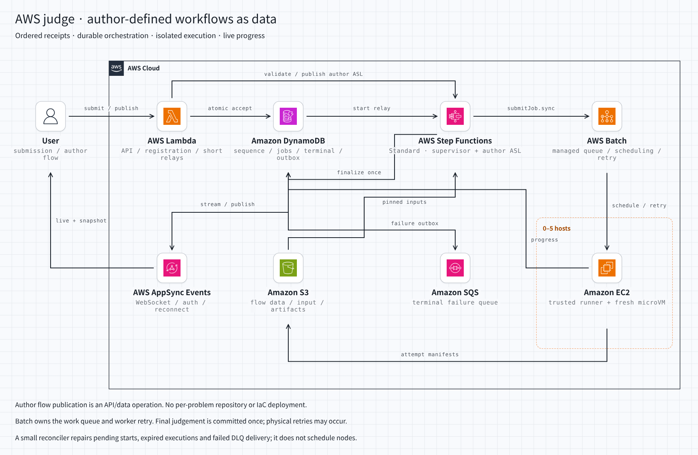

# AWS内で完結する、作問者定義フローの実行基盤

2026-11-03 JST。構成選定と保証の設計。新規PoC・deployの報告ではない。

**推奨はStep Functions Standard＋AWS Batch＋EC2。作問者のフローはASLベースのデータとして登録し、AWS APIで公開する。**
依存ノードの配布、worker lease、leader election、durable DAG engineを自作しない。
提出順・受付の冪等性・最終判定はDynamoDB、入力と成果物はS3、進捗配信はAppSync Eventsを使う。

前のNeon/PGMQ案は現在の推奨から取り下げる。AWS外の選択肢、既存PG実装、物理実行生涯1回という追加解釈を設計へ持ち込みすぎた。

## 白紙検討へ渡した条件

別々のfresh GPT-6 Astra / Maxを`fork_turns: none`で起動し、既存コード・過去の案・会話履歴を渡さなかった。
後の検討には、ユーザーが明確化した条件を最初からまとめて渡した。

- AWS内で完結するproduction構成。
- ordering：提出順を保持し、実行順は自由。
- durable execution / isolated execution / real-time進捗表示。
- EC2最大5台へのscale upを見据える。
- 作問者がフローをデータとして渡せる。問題ごとのリポジトリ・IaC変更は不要。
- Step Functionsのオーケストレーションもcustomできるものと考える。
- consumer group相当、判定1回またはDLQ、再起動、master/worker死亡を説明する。
- 既成AWSサービスの責務を利用し、自作の仕組みを増やしすぎない。

PG、Neon、既存Rust Engine、物理実行の生涯1回、特定サービスを選ばせる条件は入れていない。
公開一次資料だけで調査するよう依頼し、コード編集・AWS操作は行わせなかった。

結果は一致していない。

| 独立提案 | 残る自作部分 | 今回の判断 |
| --- | --- | --- |
| 固定Standard workflow＋汎用DSL interpreter＋SQS callback＋DynamoDB | PlanNext、依存管理、node lease/fencing、worker poller | データ定義は満たすが、DAG実行エンジンが残る |
| 固定Supervisor＋作問者ASL子フロー＋Batch scheduler | 登録・権限検証、受付接続、sandbox、結果確定、回復照合 | **こちらを推奨。問題別フローをAWSに実行させる** |

以下は後者を主案とし、ユーザーのDLQ要件に対し終端失敗のSQS配送を明示した設計。
freshの提案と、ここでの採用判断を混同しない。

[HTML](diagrams/aws-judge-orchestration.html) / [dark](diagrams/aws-judge-orchestration-dark.png)。
[stack-diagram](https://github.com/caru-ini/stack-diagram)で生成。[生成元](../../infra/scripts/aws-judge-orchestration-diagram.py)。

## 作問者が渡すのはフローのデータ

「開発者が問題ごとにASLをリポジトリへ追加する」という意味ではない。

1. 作問者がフロー定義と、checker・generator・テスト等のbundleを登録する。
2. 登録APIがASL構文とプラットフォームの制約を検証する。
3. 登録処理が`CreateStateMachine` / `UpdateStateMachine` / `PublishStateMachineVersion`を呼ぶ。
4. 問題版へ不変のstate machine version ARNとbundle hashを保存する。
5. 提出はその問題版へ固定する。実行中の問題更新でフローを差し替えない。

ASLはJSONのデータであり、APIの`definition`として渡せる。公開versionは不変。
問題ごとにAWSリソースは登録されるが、作問者のリポジトリ変更・CI・IaC deployではない。
任意のASLを`StartExecution.input`へ入れただけで動く、とは説明しない。
[CreateStateMachine](https://docs.aws.amazon.com/step-functions/latest/apireference/API_CreateStateMachine.html) /
[version](https://docs.aws.amazon.com/step-functions/latest/dg/concepts-state-machine-version.html)

公開APIには定義サイズ・state数・実行時間・並列度の制限を設け、AWSの登録数・実行数のquotaも監視する。
未使用版は提出からの参照と保存方針を確認して整理し、問題公開が無制限にAWSリソースを増やすAPIにはしない。

作問者は`Choice`、`Parallel`、`Map`、接続関係、制約内の`Retry` / `Catch`等を定義できる。
Taskの呼出先は共通のSandboxTaskへ束縛する。共通Taskが、固定されたBatch queue / job definitionを使って
`batch:submitJob.sync`し、成功attemptのS3 manifestを検証して結果を返す。
compiler/checker等のプログラムはデータbundle内にあり、sandbox内で実行する。

作問者に任意のIAM role、AWS API、host command、network設定を選ばせない。
識別子・判定版・期限などのsystem情報は作問者の引数で上書きできない。
ASLの構文検証だけでは権限検証にならないため、許可するTask・参照先・時間・並列数・反復量も検証する。
共通Task側とIAM側でも同じ制約を強制する。
[ASL検証API](https://docs.aws.amazon.com/step-functions/latest/apireference/API_ValidateStateMachineDefinition.html)

データformatの検証・必要な変換は独自実装だが、実行時の依存解決を毎回PlanNextで行うschedulerにはしない。
既存DAG形式への後方互換を理由に、独自interpreterを必須とはしない。

## 正常系：誰が何を保存するか

| 項目 | 保存先・責任者 |
| --- | --- |
| ソース・問題bundle・成果物 | S3。不変の版/内容hashで参照 |
| 受理順、冪等キー、問題版、絶対期限 | DynamoDB受付トランザクション |
| workflow起動待ち | 同じトランザクションの`START_PENDING`記録。streamは起動の合図 |
| 分岐、実行位置、待機、node retry | Step Functions Standard |
| 実行待ち、資源割当、worker障害のretry | AWS Batch queue / scheduler / RetryStrategy |
| 最終判定または終端失敗 | DynamoDBの条件付きterminal確定 |
| 終端失敗の運用配送 | SQS failure queue。DynamoDBに配送待ちを残す |
| 進捗の正本 / push | DynamoDB snapshot / Streams→publisher→AppSync Events |

受付順はscope内のcounterを条件付き更新し、提出レコード・冪等キー・起動待ちと一緒にcommitする。
同時到着はこのcommit順に直列化する。同じ冪等キー・同じ内容の再送は、既存の提出と順番を返す。
UIはこの`submissionSeq`で並べる。実行・完了をFIFOへ直列化する必要はない。
[DynamoDB transactions](https://docs.aws.amazon.com/amazondynamodb/latest/developerguide/transaction-apis.html)

起動relayは判定ID・generationから固定したexecution nameと保存済みの同じinputを使用する。
成功応答を失っても、既存executionを確認する。同名実行が終了済みの場合は`ExecutionAlreadyExists`を処理する。
90日後に名前を再利用できるため、重複防止の正本をexecution nameだけにしない。
[StartExecution](https://docs.aws.amazon.com/step-functions/latest/apireference/API_StartExecution.html)

固定Supervisorが、問題版の子workflowを待機し、最後に結果schemaを検証する。
子workflowの共通SandboxTaskはBatchへjobを投入し、`.sync`で完了を待つ。
Batchの成功response自体をjudge結果のJSONとは扱わない。manifestはBatch job ID・attempt別に保存する。
[Batch連携](https://docs.aws.amazon.com/step-functions/latest/dg/connect-batch.html)

## SQS実行キューを使わない場合のconsumer group相当

**主案ではBatch job queueとschedulerが担う。** 受付台帳を複数workerが奪い合う独自queueにはしない。

- Batchがjobを永続管理し、実行資源が空けば配置する。
- ホスト上のECS agent等のAWS管理機構がjobを開始する。自前のSQS poller、lease更新、master electionはない。
- worker/EC2死亡はRetryStrategyにより、同じBatch jobの次attemptへ進む。
- job単位の再試行数と、workflow単位の期限・retry方針を別に定義し、無制限のretry積算を避ける。

これはKafkaのpartition offsetを自作することではなく、競合consumerへ配置する責務をBatchへ任せること。
`SUBMITTED → PENDING → RUNNABLE → STARTING → RUNNING → SUCCEEDED/FAILED`の管理を借りる。
[Batch job states](https://docs.aws.amazon.com/batch/latest/userguide/job_states.html) /
[自動再試行](https://docs.aws.amazon.com/batch/latest/userguide/job_retries.html)

## 判定1回またはDLQへ収束する条件

保証対象は**最終判定を一度だけ確定すること**。worker故障によるプログラムの再実行はあり得る。
「物理実行が生涯1回」という条件を追加して、開始権の不可逆marker等を必須にしない。

状態には少なくとも`START_PENDING / RUNNING / FINALIZING / JUDGED / DLQ_PENDING / DLQ`を持つ。
`(submissionId, generation)`のterminal outcomeを、未確定の場合だけDynamoDB transactionで作る。
確定済みなら同じ結果を返し、成功・期限超過・失敗が競合しても終端を上書きしない。

WA / CE / TLE / RE / MLEはjudge結果。基盤障害と区別し、正常なBatch job outputとして返す。
runner自体の異常、VM起動不能、成果物不備等がretry / failureの対象になる。

全体の絶対期限は受付時に固定する。Batchの`RUNNABLE`は資源不足時に無期限になり得て、
Batch timeoutは`STARTING`を含まない。そのためBatchのretryと実行timeoutだけではeventual終端を証明できない。
Supervisorの期限と、独立した期限照合で穴を閉じる。
[job states](https://docs.aws.amazon.com/batch/latest/userguide/job_states.html) /
[Batch timeout](https://docs.aws.amazon.com/batch/latest/userguide/job_timeouts.html)

終端失敗では、失敗理由・入力参照・問題版・execution/Batch job参照を台帳へ保存し、
failure queueへの配送待ちを同じtransactionで記録する。relayがSQSへ送信し、未配送なら再送する。
SQS送信の成功を確認してから配送状態を`DLQ`へ変更する。未確認なら`DLQ_PENDING`とoutboxを残す。
論理的な失敗確定と、SQSへの配送完了を分ける。
送信後の応答消失ではmessageが重複し得るが、論理的な失敗は同じ判定IDの1件。
SQSの保持期間後も、失敗台帳と入力参照は保持する。

Batch jobの`FAILED`、SQSにmessageがあること、判定全体の`DLQ`は同じものではない。
子nodeが失敗しても作問者フローでfallbackできる。Supervisorが最終失敗を選んだ場合だけ判定DLQになる。

### 停止時のシーケンス

| 障害の時点 | 残る事実 | 回復・終端化 |
| --- | --- | --- |
| 受理commit前にAPI死亡 | 受理未確定 | 同じ冪等キーで再送 |
| 受理commit直後にAPI/relay死亡 | `START_PENDING`と入力参照 | stream再送または定期照合が起動 |
| StartExecution成功後にrelayが応答を失う | 固定name/input、既存execution | 照合して継続。別IDで二重workflowを起こさない |
| Lambda等のアプリ再起動 | 進行状態はSF/Batch/DynamoDB | メモリからの復元やmaster再選出は不要 |
| master相当のLambda死亡 | SFのstateと入力が残る | retry可能な短い処理だけ再実行。副作用は冪等 |
| Step Functions制御面が一時停止 | Standardの永続状態、Batch job | AWS復旧後に継続。非成功で終了したexecutionは照合で回収 |
| Batch schedulerの一時障害 | AWS管理job queue、受付台帳 | AWS復旧後に配置。期限を過ぎていれば失敗終了 |
| worker/EC2が実行中に死亡 | Batch job/attempt、S3入力 | Batchが有限回retry。上限ならフローのCatchまたは最終失敗へ |
| SubmitJob成功後に応答を失う | queue上のjob、system識別情報 | 照合でjobを発見し追跡。再送による重複jobも回収対象にする |
| 成果物保存後にworker死亡 | attempt別S3 object | 他attemptとは混ざらない。成功attemptのmanifestだけを採用 |
| `.sync`完了通知が遅れる | Batch側のterminal state | managed統合の照会で回収。全体期限も維持 |
| verdict確定後に応答消失 | terminal record | 再実行は既存結果を返す。新しいverdictを作らない |
| timeoutと成功が競合 | 同一terminal key | 条件付き確定で一方だけ採用 |
| 古いworkerが遅れて戻る | 古いattemptの成果物 | workerに提出terminal更新権限を与えず、採用済み結果を上書きさせない |
| workflowがFAILED/TIMED_OUT/ABORTEDで終了 | 非終端の台帳、execution ARN | 照合が保存済み結果の回収または失敗終端を行う |
| DLQ送信中にrelay死亡 | failure配送待ち | 再送。verdictへ終端を変更しない |
| 全worker再起動 | SF/Batch/DynamoDB/S3 | 配置・retryを再開。RAM上の状態は保証対象にしない |

### Reconcilerを置く理由と範囲

DynamoDB Streamsは24時間保持、Step Functions→EventBridge通知はbest effort。
workflow自身のtimeout・未処理例外・強制停止を、必ず自身のCatchで回収できるわけではない。
通知だけではeventualを主張しない。

定期照合は、未起動・未終端・期限超過・DLQ未配送の台帳だけを見る。
個別nodeを配布したり、依存を解決したり、workerの所有者を選出したりしない。
jobの終端判定と未完了の外部配送を修復する、限定された処理とする。
[Streamsの保持](https://docs.aws.amazon.com/amazondynamodb/latest/developerguide/HowItWorks.CoreComponents.html) /
[SF通知](https://docs.aws.amazon.com/step-functions/latest/dg/eventbridge-integration.html)

`.sync`中断時のjob取消しはbest effort。workflow停止だけで、計算資源がすべて止まったとはしない。
既知の子execution/jobをCancel/Terminateし、終了を確認するcleanup記録を持つ。
投入時にはsystem側で固定した提出ID・generation・node invocation識別子をjobNameとtagsへ付ける。
`SubmitJob`のjobNameは冪等キーではない。応答消失でjob IDが未記録でも、対象queueを投入時刻・nameで
ページ走査し、DescribeJobsのtagsと照合して発見する。失敗した投入の再送による重複も含め、終端後もcleanup完了まで追跡する。
runnerは開始時に台帳のgeneration・terminal・絶対期限を確認し、期限切れや確定済みならguestを開始しない。
台帳を確認できない場合もguest開始を許可しない。guestの細かいwall上限も独立に強制する。
判定の終端と資源の後片付けを混同しない。
[同期統合の取消し](https://docs.aws.amazon.com/step-functions/latest/dg/connect-to-resource.html)

以上のeventualは、AWSが復旧し、定期照合とworker供給/権限/データ保持が維持されることを前提とする。
永続的なサービス停止中まで完了を約束するものではない。

## 隔離と最大5台

Batch/ECSを導入するだけで敵対的コードの隔離が完成するとはしない。
trusted runnerの子としてFirecracker等のmicroVMを起動し、compile・提出・checkerも隔離対象とする。
guestにはNIC、AWS資格情報、host filesystemを渡さない。
VMとcaseのCPU/memory/pids/wall/output/file上限、jailer/seccomp、host/guest kernel更新はrunner運用の責務。
[ECSのEC2上での境界](https://docs.aws.amazon.com/AmazonECS/latest/developerguide/task-iam-roles.html) /
[Firecracker production guidance](https://github.com/firecracker-microvm/firecracker/blob/main/docs/prod-host-setup.md)

VMはBatch taskの子cgroup内へ置き、task停止後にhost上へVMMを取り残す構成にしない。
対応EC2のnested KVMが現行の選択肢にある。metal必須という旧前提で除外しない。
[EC2 nested virtualization](https://docs.aws.amazon.com/AWSEC2/latest/UserGuide/amazon-ec2-nested-virtualization.html)

最大5台は、単一instance type＋On-Demand `BEST_FIT`＋`maxvCpus=5q`を候補とする（qは1台分のvCPU）。
`BEST_FIT_PROGRESSIVE`等では最大1台分の超過があり、maxvCPUだけで5台を保証したとはしない。
`BEST_FIT`のinfrastructure update制約、compute environment交換時の新旧合計も運用で管理する。
実際のCPU登録数とjob予約量を合わせ、1ホスト同時何jobかも明示する。
[ComputeResource](https://docs.aws.amazon.com/batch/latest/APIReference/API_ComputeResource.html)

idle固定費を抑える場合は`minvCpus=0`。常時2台は今回の必須条件ではない。
Batch自体の追加料金はなく、EC2等の使用分を払う。常時DB compute、NAT、ALB、有料endpointは必須にしない。
無負荷時にもDynamoDB/S3/AMI等の保存と少量の照合費は残る。
EC2 cold起動が入るため、これを冷状態から10秒以内の保証とはしない。
[Batch料金](https://aws.amazon.com/batch/pricing/)

## real-time進捗

進捗はtrusted runnerがDynamoDBへ保存し、streamのpublisherがAppSync Eventsへ通知する。
`submissionId / generation / nodeId / attempt / revision`を持たせ、重複・古いattemptを現在の状態へ混ぜない。
workerにterminal更新の権限は与えない。最終verdictはSupervisorが共通の条件付き確定処理を通して確定する。
Supervisorが異常終了した場合だけ、reconcilerが同じ確定処理で回収する。

初回・再接続時はsnapshotを取得する。購読開始とsnapshot取得の間の欠落も考慮して、
購読中のイベントをbufferしsnapshotのrevisionより新しいものを適用する。
publisher障害や通知欠落はsnapshotの再取得で修復する。WebSocketだけを正本にしない。
接続中も非終端の提出は低頻度でsnapshotを再取得し、最後の通知だけ欠落した場合も終端へ追いつく。
[AppSync Events](https://docs.aws.amazon.com/appsync/latest/eventapi/event-api-concepts.html)

## 自作する範囲を限定する

残すもの：作問者データ登録・安全なASL束縛、受付の順序/冪等性、起動とDLQ配送の接続、sandbox runner、
manifest検証、terminal条件付き確定、限定reconciler、進捗schemaと再同期。

作らないもの：分散DAG scheduler、consumer group、worker lease/master election、独自durable engine。

SQS callback案も成立する。同じ実行キューのcompeting consumers、visibility/再配送、task tokenで構成できるが、
poller・backpressure・heartbeat・message削除との境界・worker lifecycleは自分たちの責務になる。
今回はその部分をBatchへ任せる案を選ぶ。SQS failure queueは終端失敗の運用配送として残す。

この資料は保証の設計と選定根拠であり、上記プロトコルが実装・検証済みという主張ではない。
