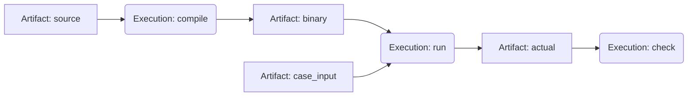

# AWS 上のジャッジ実行

`develop-hayatroid` の ephemeral CDK スタックを、実行ノード単位のジャッジ経路に拡張した。制御は既存の Rust `Engine`、保存は PostgreSQL、入力・生成物は版を固定した S3 オブジェクト、要求・結果は SQS を使う。ワーカーは EC2 上の監督プロセスから、資格情報とネットワークを持たない Docker コンテナを起動する。

[操作できる構成図](stack-diagram/aws-judge.html)で、AWS 配置、ファイルと実行の二部DAG、制御・データの時系列、対話セッション、各判定方式を切り替えられる。図は [stack-diagram](https://github.com/caru-ini/stack-diagram) のテンプレートとビルドスクリプトを利用する。

このスタックが完結させるのは、内部 API への実行投入から、依存順のノード実行、成果物の回収、結果取得までである。一般利用者の認証・問題登録の公開 API・neoShowcase からの接続・メール配送は含めない。内部 ALB は HTTP、PostgreSQL は証明書検証付き TLS、AWS API は HTTPS とする。操作は IAM で認可された SSM 経由で行う。

## AWS の配置

| 構成 | 配置と責務 |
| --- | --- |
| VPC | 2 AZ。public subnet と DB 用 isolated subnet。NAT Gateway は使わない |
| 内部 ALB | `/health` と内部ジャッジ API を controller へ転送。インターネットには公開しない |
| Controller EC2 | `traojudge-judge`。Core の検証・DAG→Job変換と Workflow Engine、結果 inbox、再開処理、ケース数、監査イベント |
| RDS PostgreSQL | isolated subnet。Controller の Security Group だけが接続できる。Workflow と実行定義・成果物参照・結果を保存 |
| S3 | 非公開・暗号化・Versioning。入力、実行試行別の生成物・ログ、Job ごとの確定結果 |
| SQS | Standard の要求・結果キュー。各キューに DLQ。可視性延長と永続的な受理後の削除 |
| Worker EC2 | 要求を受け、入力を取得・検証し、1実行ノード分の sandbox 群を管理。DAG の後続選択や DB 接続はしない |
| ECR | CDK の DockerImageAsset。配布後に digest を取得し、その同じ不変参照を controller と worker に設定 |
| IAM / Secrets Manager | Controller と Worker の role を分離。DB secret は Controller だけ。提出プログラムに role・secret・Docker socket は渡さない |
| CloudWatch Logs / SSM | 監督プロセスのログと管理操作。補助の S3 削除 Lambda のログもスタック所有の LogGroup に集約 |

Controller と Worker の EC2 は AWS API と ECR に outbound 接続するため public subnet に置く。Worker には inbound rule がなく、Controller の 8080 は ALB の Security Group からだけ受ける。どちらも IMDSv2 必須。子 sandbox は `--network none` なので IMDS に到達しない。

## 二部DAGと実行要求



Artifact は名前を持つファイルの定義で、Job ではない。入力 Artifact は具体的な ObjectRef を持ち、中間 Artifact は生成する Execution を1つ持つ。問題定義の JSON 全体も Artifact と自動的に同一視しない。

Core の `OnePlayerJudgeContract::start_dag_with_ids` は、上のファイル依存から `compile → run → check` の Job 依存を導く。複数ファイルを介した同じ Job 間の依存は1辺になる。指定した PipelineId / JobId を保持して同じ計画を再開できる。既存の `start_dag` は従来どおり新しい ID を発行する。

SQS の要求は Execution 1個分であり、DAG 全体ではない。後続を起動できるか判断するのは Controller である。前段が生成物を S3 へ保存し、その版とハッシュを含む結果を Controller が永続的に受理した後で、後続へその参照を渡す。

## 転送する契約

Rust 定義は `server/traojudge-judge/src/protocol.rs`、Worker 側の解釈は `deploy/judge/worker.py` に置く。SDK の型は wire contract に含めない。

| 型 | 内容 |
| --- | --- |
| `Definition` | `schema_version: 1`、固定した image、Artifact 宣言、Execution 宣言 |
| `ObjectRef` | bucket、key、version_id、SHA-256、小文字16進、byte_length、executable。最新版を暗黙に取得しない |
| `Execution` | 入出力、予約変数の結び付け、main の入力集合、peer、制限、case_id、judge_errors |
| `Template` | 保存する起動 Payload。既知の入力参照と、前段の受理後に解決する中間ファイル名 |
| `Task` | JobId・run_id・Execution・実体が確定した全入力参照。ファイル本体を SQS に載せない |
| `NodeResult` | completed/failed、main の JSON object、生成物とログの ObjectRef、プロセス終了情報、エラー |

Controller は初期入力と結果の S3 VersionId・サイズ・S3 の SHA-256 checksum を検証する。Worker は指定版をストリーム取得して、実際の内容の SHA-256 とサイズを照合してから sandbox へ配置する。実行可能ビットも受け渡すので、コンパイル済みバイナリを後続で実行できる。

現在の制限は、1ファイル512 MiB、入力合計1 GiB、1要求128 KiB、1セッション最大9プロセス、各プロセスのwall time最大300秒である。メモリー・CPU・PID・ファイルサイズの上限は protocol と worker の両方で検証する。

## 実行と結果の境界

main は `TRAOJUDGE_INIT_SCRIPT` の入力ファイルを `sh` で起動する。入力は `/work/inputs/<name>` に読み取り専用で配置し、宣言した環境変数にそのパスを渡す。出力は `/work/outputs/<name>`。main の stdout は1つの JSON object、stderr はログとする。任意の stdout ログを混ぜると失敗する。

各プロセスは別の Docker コンテナで動く。root filesystem は読み取り専用、UID/GID は65534、capability は全削除、no-new-privileges、network none、メモリー・CPU・PID・ファイルサイズ制限を設定する。書き込み先は出力ディレクトリと容量を制限した tmpfs に絞る。生成物は通常ファイルで、シンボリックリンクや複数hardlinkを拒否する。

WA は main が返す判定データであり、Job の失敗にはしない。`judge_errors: true` を指定した出力のないノードでは、監督した timeout / OOM / 非ゼロ終了を TLE / MLE / RE の判定データに変換する。これにより他のケースを継続できる。必須ファイルが生成できない前処理、壊れた stdout、転送・基盤エラーは failed として同じ Pipeline をキャンセルする。

汎用の判定意味づけを worker が推測するわけではない。ファイルを生成するケース処理で異常時も後続を動かす場合は、作問側の監督スクリプトが判定レコードを常に生成するように定義する。

## 対話と対戦

interactive や対戦の会話を Artifact の辺にしない。DAG の辺は、完成したファイルの受け渡しである。対話全体を1つの Execution とし、その内部を session として扱う。

main は `TRAOJUDGE_CHANNEL_DIR/<peer>/from-main` と `to-main` を使う。peer は自分専用の `TRAOJUDGE_CHANNEL_IN` / `TRAOJUDGE_CHANNEL_OUT` を使う。いずれも FIFO であり、S3 を会話の転送には使わない。main の stdout は最終結果 JSON 用に保つ。

main と各 peer は別の入力集合を持つ。例では interactor・referee と非公開データを main にだけ渡し、提出コードとその起動スクリプトを peer にだけ渡す。main が終了したら残った peer を停止する。通信ログやリプレイを残したい場合は main が宣言出力ファイルに記録する。

| 方式 | 実行できる例 |
| --- | --- |
| 通常判定 | C をコンパイル → 入力で実行 → 42 を確認 |
| heuristic | seed 0/1 の独立実行 → score ファイル → 平均得点33.0へ集約 |
| run-twice | 別sandboxのrun_1がstate_1を生成 → run_2がstate_2を生成 → 値2を確認 |
| interactive | interactorと提出を別sandboxに配置。21を送り42を受信。transcriptを保存 |
| coding-game | refereeと2提出を別sandboxに配置。得点a=4、b=5、勝者b。replayを保存 |
| timeout | 出力のないケースの時間制限超過をTLEとして受理 |
| mixed_cases | WA / TLE / ACの3ケースを同じDAGで完了。ケース数3を取得 |

例と期待値は `deploy/judge/examples.py` に集約し、ローカルの Docker テストと実AWS検証で同じものを使う。

2026-11-08にap-northeast-1へCDKで構築し、上記7シナリオがすべて完了することを確認した。内部ALBの疎通、実行中のController再起動、同じ結果の再配信、同じrun_idの再投入、入力キーを上書きしても指定した旧版を読むこと、誤ったSHA-256の投入拒否も通過した。検証スタックはCDKで削除し、CloudFormation上に存在しないことも確認した。アカウントや実リソースの識別情報を除いた[実測結果とイベント](aws-judge-verification.json)を保存し、構成図の「実AWSの記録」に同じデータを埋め込んでいる。

## 再配信と再起動

1. 実行定義を `judge_runs` に保存する。run_id と実行名から安定した JobId を導く。同じ run_id に別の定義を入れることは拒否する。
2. Engine は Job・依存辺・Ready状態を PostgreSQL の同じ UnitOfWork で保存する。Starting を保存してから SQS へ送る。Ready/Starting は保存した計画から再送できる。
3. Worker は試行ごとに別の S3 prefix へ生成物を保存し、Jobごとの `result.json` を条件付き PUT で一度だけ確定する。再配信時に確定結果があれば再送する。
4. Controller は結果 inbox と成果物参照を同一transactionで保存してから Engine の完了処理を行う。途中停止したら inbox を再適用する。Engine のCASと結果の一意制約により、同じ結果で後続を二重に進めない。
5. 結果を永続的に受理・適用した後に SQS メッセージを削除する。壊れたメッセージは再配信後にDLQへ移る。

計算自体は at-least-once であり、同じ Job が並行に再計算される可能性はある。確定結果と後続反映を一意にする。heuristic の明示的な別試行・再ジャッジは別run_idを使う。異なるrun間で判定を自動キャッシュしない。

PostgreSQL実装は `server/traojudge-infra/src/postgres/workflow/`。既存の `JobRepository` / `EdgeRepository` / `PipelineRepository` / `UnitOfWork` を実装し、CoreやWorkflowにAWSの依存を持ち込まない。

`core::ports::realisation::Realiser` はRust内の単一ファイル実体化traitのままである。今回の別プロセスWorkerはそのtraitを直接実装せず、versionedなTaskを受け、`worker.download`で同じ「内容を検証して指定ファイルへ配置する」操作を実行する。依存解決は引き続きController側にある。

## 再現手順

AWS側の制約は [infra/PATTERNS.md](../../infra/PATTERNS.md) に従う。ブランチ名のprefix、固定の物理名を付けないこと、全リソースのDESTROY、S3のautoDeleteObjectsを維持する。公開リポジトリへアカウントID・ARN・実URLを書かない。

必要なものはRust 1.95、Node.js/npm、Docker、Python 3.11以上とboto3、AWSのCDK権限である。ControllerのバイナリはDebian trixie/glibc 2.41のruntime imageで動かすため、ビルド側は同等以下のglibcを使う。異なるOSでは同じDebian環境でビルドする。

```sh
python3 -m venv /tmp/traojudge-venv
/tmp/traojudge-venv/bin/pip install -r deploy/judge/requirements.txt
export JUDGE_PYTHON=/tmp/traojudge-venv/bin/python
export JUDGE_WORK_DIR=/tmp/traojudge-proof
infra/scripts/verify.sh
```

このスクリプトはprepare、CDK synth/deploy、7シナリオ、S3版固定・チェックサム拒否・重複結果・重複投入・Controller再起動の検証、destroyを行う。終了時は成否にかかわらずそのブランチのスタックを削除する。検証中の値はJUDGE_WORK_DIRだけに保存し、commitしない。CDK bootstrapの共有アセット保管先は他タスクも使うため削除しない。

個別に起動・削除する場合も、動作確認後に必ずdestroyする。

```sh
infra/scripts/prepare.sh
cd infra
npm ci
npm run build
npx aws-cdk deploy --all --require-approval never
# IAMで認可されたSSM経由で /health と /runs を操作する
npx aws-cdk destroy --all --force
```

### ローカルの検証

```sh
cargo test -p traojudge-core -p traojudge-workflow -p traojudge-cli
cargo test -p traojudge-judge
# disposableなPostgreSQLにDATABASE_URLを設定する
cargo test -p traojudge-infra --test workflow_postgres -- --ignored
# prepareしたruntimeをDockerでビルドした後
JUDGE_TEST_IMAGE=$(docker image inspect --format '{{.Id}}' traojudge-runtime:aws-test) \
  python3 -m unittest discover -s deploy/judge/tests -v
cd infra
npx aws-cdk synth --quiet
python3 -m unittest discover -s tests -v
```

Dockerビルド中に通信を検査するproxy CAが必要な環境では、`CODEX_PROXY_CERT`をBuildKit secretとして渡す。CAをimageへ残したりTLS検証を無効にしたりしない。CDKもこの変数がある場合は同じsecretを使う。

## 運用範囲

これは実行可能なephemeral検証スタックであり、公開本番サービスの完成を意味しない。EC2各1台、RDS単一AZ、短期保持である。Dockerはホストkernelを共有し、microVMによる分離は提供しない。公開認証、任意の利用者による投入、永続的な監査・保持、ホスト障害時の自動交換、負荷に応じたスケーリング、追加言語image、動的な対戦カード生成は別途必要になる。

現在は全DAGでスタックの固定imageを使う。既存の`judge-command/`のNix言語環境からimageを生成する接続や、言語IDの公開APIとの対応はこの変更には含めない。
