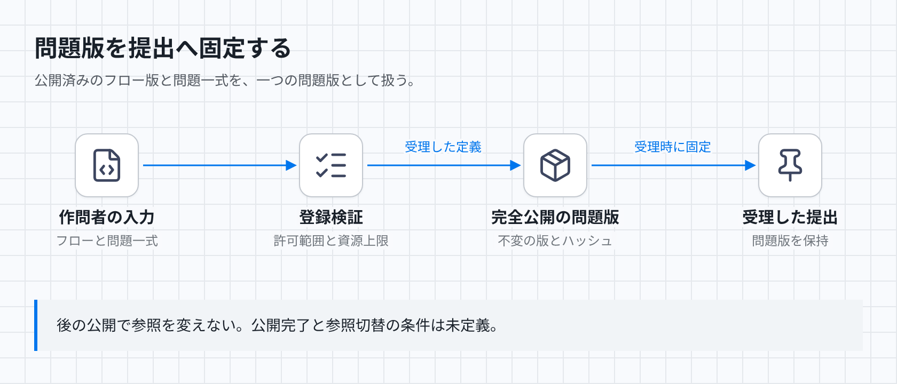

# 作問者定義と問題版の契約

作問者は判定フローと問題一式をデータとして登録する。問題ごとのリポジトリ変更やインフラ定義のデプロイを登録条件にしない。本書は登録と版の参照を扱い、実装済みという主張はしない。

[図のHTML](../diagrams/author-workflows.html) · [暗色PNG](../diagrams/author-workflows-dark.png)

## 入力と保存状態

入力は作問者、対象問題、フロー定義、採点プログラム・生成器・テストを含む問題一式である。フロー定義と、提出ごとに渡す入力は別に扱う。保存する問題版は、不変のフロー版参照と問題一式のハッシュを組にする。受理した提出は問題版を保持し、その後の公開で参照先を変えない。

登録時と実行時に使う共通処理の許可範囲、権限、資源上限は基盤が決め、作問者の入力では変更できない。

## 検証と公開の規則

分岐、並列、反復と、制約内の再試行・失敗処理を許可する。呼び出せる処理は基盤が許可した共通処理に限る。作問者は実行ロール、任意の外部API、ホストコマンド、ネットワーク設定を指定できない。共通処理の実行先も基盤が固定する。

構文検証だけでは安全性を判定しない。参照先、定義サイズ、状態数、実行時間、並列数、反復量を検証し、共通処理の引数と実行権限でも制約を強制する。個々の処理が許可対象でも、反復や再試行の合計で資源上限を超える定義は受理できない。上限値と合計量の算定規則は未定義のため、境界値での合否は審査保留となる。

提出を識別する提出ID、再判定を区別する世代`generation`、絶対期限は基盤の制御情報である。作問者定義による入力の変換や処理の出力で上書きしてはならない。制御情報を隔離する表現と、各状態を通過した後の照合方法は未定義である。

公開済み問題版は変更しない。新しい定義は新しい問題版として公開し、提出から参照される版と問題一式を保持する。保存方針の確認なしに未使用と判断して削除してはならない。

## 入力列に対する期待結果

問題版を公開し、提出を受理した後で採点プログラムを更新する。先の提出は元のフロー版と問題一式を使う。新しいプログラムだけを混ぜた実行は契約違反である。

許可されない処理を登録する場合も、許可された処理から実行ロールや期限を差し替える場合も、登録成功として公開しない。検証を通った定義でも、実行時に作問者の値を制御情報として採用すれば契約違反である。

新しいフロー版を作成した後、問題一式の保存前に提出が到着する。期待する結果は、完全に公開された一つの問題版への固定である。現案は公開完了の保存状態と参照切替の条件を定めていない。この入力列で旧版を使うか、受付を待たせるか、拒否するかは判定できない。

登録が成功した直後に応答が失われ、作問者が同じ内容を再送する。現案には同じ登録要求を識別する冪等キー、成功済み登録の照会、同内容の版を再利用する規則がない。既存版を返すか別版を作るか、作問者が成功をどう確認するかは判定できない。
