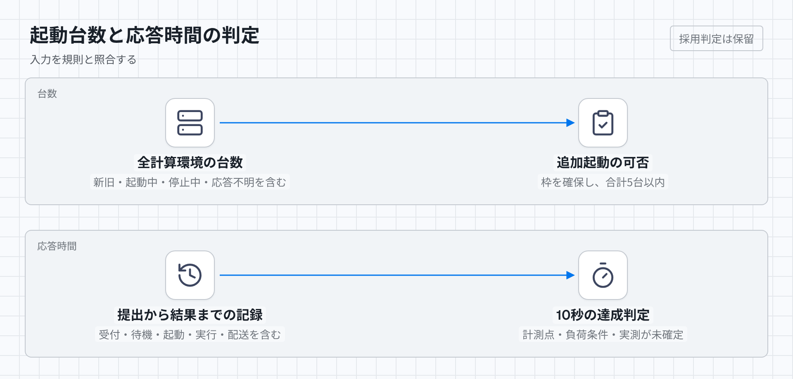

# 起動台数と10秒応答

EC2の実台数を5台以内に保ち、提出から結果まで10秒以内に収められるかを判定する。実行機が0台の状態も対象にする。

## 判定に必要な入力

実行中だけでなく、起動要求済み、停止処理中、入れ替え中の新旧インスタンスを数える。対象の範囲は一つの計算環境ではなく、同じジャッジが使用する全計算環境とする。

時間は、提出データの受信、受理確定、配置、起動完了、コンパイル完了、判定完了、画面への結果到達を同じ時計基準で記録する。時計のずれと計測誤差も記録する。10秒の開始点と終了点、集計方法、同時提出数と到着間隔、問題ごとの最大処理量を試験条件に含める。

## 満たすべき規則

起動要求を出す前に台数枠を確保し、同時の要求が同じ枠を使わない。起動要求が成功したか不明な機体を、台数の集計から消してはならない。停止要求だけでも枠を空けず、停止完了を確認する。計算環境やAMIを交換するときも、新旧の合計が5台を超える起動は許可しない。

結果までの時間には、受付、待ち行列、実行機の起動、転送、コンパイル、全ケースの実行、採点、結果の確定、指定した終了点までの結果配送を含める。実行開始後だけを測って10秒達成とはしない。

## 反例と期待結果

| 与えた事実 | 期待する判定 |
| --- | --- |
| 4台が稼働し、1台の起動要求は応答不明 | 追加起動を許可する根拠がない。先に不明な1台を照合する |
| 4台が稼働し、同時に2件の起動要求が届く | 追加の枠は1台分だけ確保できる。両方を起動する構成は不合格 |
| 旧環境に3台、新環境に3台が存在する | 各環境が上限内でも、全体の5台制限には不合格 |
| 5台のうち1台へ停止要求したが、まだ停止していない | 追加の1台を起動できない |
| 0台からの起動だけで11秒かかった | 判定本体が短くても10秒要件には不合格 |
| 判定本体に10秒必要で、受付や起動にも時間がかかる | その問題を10秒以内に返すという約束は成立しない |

## 未定義・未検証事項

判定は保留である。台数の規則は上記の入力で審査できるが、AWS Batchの設定が入れ替え中まで含めて守るかは未検証である。単一機種と`BEST_FIT`を候補にしている。[他の割当方式では設定値を最大1台分超える場合がある](https://docs.aws.amazon.com/batch/latest/APIReference/API_ComputeResource.html)。

10秒については、計測の開始点と終了点、集計方法、想定する到着量、処理量、停止状態からの起動時間が未確定である。[過去の起動測定](../fairness-experiment.md)は別の構成であり、この案の証拠には使えない。これらを固定した試験記録が揃うまで、無負荷時0台と10秒の同時達成を合格にしない。

[HTML版](../diagrams/capacity-latency.html)・[暗色版](../diagrams/capacity-latency-dark.png)
