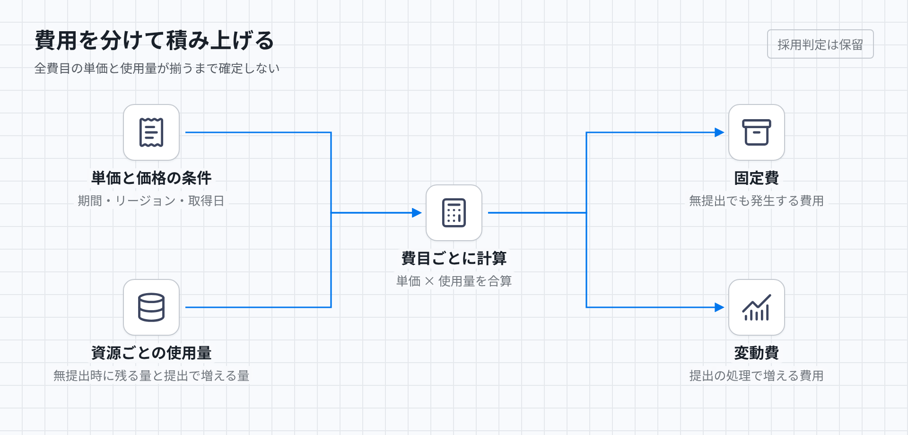

# 無提出時の費用と利用量に応じた費用

同じ期間について、無提出でも発生する費用を固定費、提出の処理で増える費用を変動費として分けて判定する。月10ドルは台数調整の予算感であり、受理済み提出を打ち切る上限ではない。

## 判定に必要な入力

対象期間、リージョン、価格の取得日、割引を含めるかを固定する。通貨と税の扱いも統一し、異なる通貨や課金単位の金額を換算せず加算しない。無提出時の許容費用と、提出数、問題ごとの処理量、保存量、保持期間を与える。各資源について、単価、課金単位、無提出時にも残る量、提出処理で増える量を列挙する。

EC2には起動中・待機中・停止処理中を含む総稼働時間、ディスク、IPアドレスを含める。保存には問題、提出、成果物、AMI、ログと保持期間を含める。状態遷移、API、通知、転送、定期照合も計上する。常設の受付処理、状態保存、バックアップ、監視、ネットワーク設備の費用と最低料金も含める。使わない資源は使用量0として列挙し、費目の抜けと区別する。

## 計算規則

各費目の単価に使用量を掛け、全費目を加算する。無提出の試算でも、既存データの保存と定期照合が残るなら計上する。EC2を停止状態で残す場合は、残ったディスクの費用を計上する。

実行機の使用量は、台数ごとの稼働時間を合計する。最大5台という設定だけから月額は決まらない。無料枠やクレジットを使う場合は、適用前後の費用を併記する。

## 反例と期待結果

| 与えた事実 | 期待する計算・判定 |
| --- | --- |
| EC2が0台だが、保存データと定期照合が残る | EC2の計算費だけを0にし、保存と照合を加算する |
| 5台を4時間使う場合と、1台を20時間使う場合 | 同一単価ならEC2の計算費は等しい。他の費目は別に計算する |
| 無提出でも常時2台を維持する | 2台分の月間稼働時間を固定費へ含める |
| 試算にディスク、通知、転送の単価がない | 合計や月10ドル以下を確定しない |
| 今月の支出が10ドルを超えた | この予算感だけを理由に受理済み提出を破棄しない |

## 未定義・未検証事項

判定は保留である。実行機を0台にできればEC2の無負荷時の計算費はなくせるが、請求全体が0になるとは限らない。無提出時に許容する金額、保存量と保持期間、提出時の利用量がまだ固定されていない。

[保存済みの料金原票](../production-judge-prices.json)は一部サービスの単価であり、現案の全費目を覆わない。全費目の単価と使用量をこの計算へ代入できるまで、無提出時の費用や月10ドル達成を主張しない。

[HTML版](../diagrams/cost.html)・[暗色版](../diagrams/cost-dark.png)
