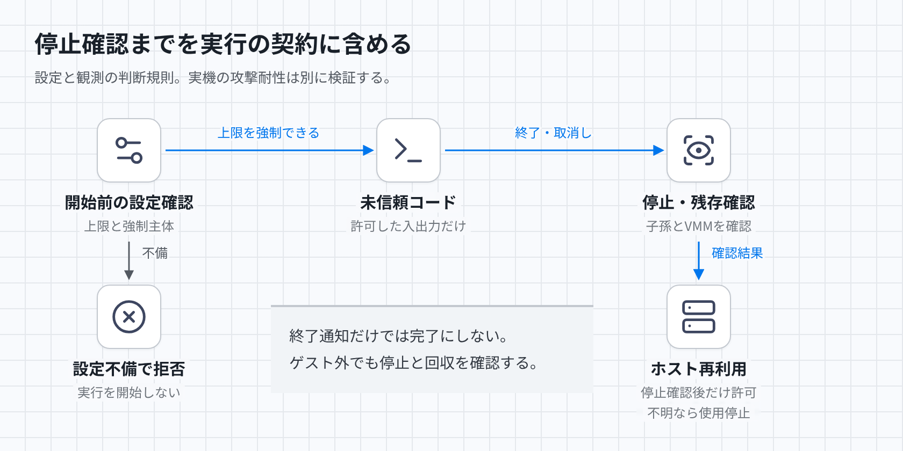

# 未信頼コードの実行隔離

## 目的と適用範囲

提出、コンパイラ、採点プログラムを未信頼コードとして扱い、許可した入力と成果物以外でホストや他提出へ影響させない。この文書は、設定と観測記録を審査するための規則である。規則に矛盾がないことだけでは、カーネルやVMMの実装による隔離を証明できない。CPU性能の公平性は[判定時間の公平性](fairness.md)で扱う。

[図のHTML](../diagrams/execution-isolation.html) · [暗色PNG](../diagrams/execution-isolation-dark.png)

## 判定に与える設定と観測

入力には、ホスト、カーネル、VMM、ゲストイメージの版とハッシュを含める。jailerとseccompの設定、権限、公開デバイス、マウント、資格情報の配置、許可するファイルと通信経路も与える。VMMは仮想マシンを管理するホスト側プロセスである。VMと各実行についてCPU時間、実時間、メモリ、プロセス数、出力量、ファイル容量と個数の上限、および強制する主体を与える。ホストの使用可能なメモリと保存容量、同時実行数、実行ごとの予約容量を与える。予約容量にはVMMと回収処理の消費も含める。

観測には、ゲストとVMMの資源使用量、上限到達、終了理由、子孫プロセス、cgroup、作業領域の停止・削除確認を含める。ゲストの自己申告だけでは停止確認にしない。いずれかの上限が未設定、強制不能、設定確認不能なら、実行を開始せず設定不備として拒否する。

## 許可する経路と禁止する経路

信頼する実行管理プログラムだけが入力を用意し、容量制限付きの成果物を回収する。提出と採点プログラムの間も、定義したファイルと通信経路だけを許可する。共有可能なイメージは読み取り専用にし、提出とケースの書込み領域を分ける。

ゲストにはNIC、AWSなど基盤の資格情報、ホストのファイルシステム、他提出の領域、VMM制御口を渡さない。資格情報サービスを含む外部通信を禁止する。コンパイラも同じ境界内で実行し、ソースからの攻撃をホスト上で処理しない。fork、メモリ確保、無限出力、ファイル作成の各爆弾は、ゲスト外からも強制する上限で停止する。出力を回収する側も、無制限にメモリやディスクを消費しない。

## 停止後まで維持する不変条件

実行ごとのVMMとホスト側の子孫プロセスは、親タスクの子cgroupに属し、制限外へ移動できない。予約容量の合計とホスト処理の消費を合わせても、ホストのメモリと保存容量を使い尽くさない。成功、制限到達、取消し、親タスク停止のすべてで子孫とVMMを停止し、残存がないことを確認する。終了通知だけでは片付け完了にしない。確認できないホストは次の提出に使わず、停止確認を追跡する。後続ケースへ書込みやプロセスを残さない。

ホスト、実行管理プログラム、VMM、カーネル、仮想化基盤は信頼対象である。ゲスト内の制限だけに頼らず、ホストの更新と最小権限を前提にする。ホスト侵害後の隔離継続はこの契約では保証しない。

## 反例と期待結果

- 提出が外部通信や他提出の読出しを試みても到達できず、他提出の内容は変わらない。
- 採点プログラムが子プロセスを増殖させると、その実行の上限で停止する。他提出のプロセスは停止しない。
- 親タスクを停止してVMMが残る構成は不合格となり、ホストを再利用しない。
- 出力上限に達した後も回収側の保存量が増える構成は不合格となる。

## 未検証事項

判定は保留である。[構成案](../aws-judge-orchestration.md)ではFirecrackerを候補にしているが、具体的な上限値、強制設定、残存確認、攻撃試験の証拠がない。[Firecrackerの運用要件](https://github.com/firecracker-microvm/firecracker/blob/main/docs/prod-host-setup.md)への適合記録も必要となる。設定が規則を満たすことと、実際の脱出・資源枯渇攻撃に耐えることは別に検証する。[過去の実測](../fairness-experiment.md)は既定の試験プログラムだけを実行したため、任意コードの攻撃耐性の合格証拠にはしない。
