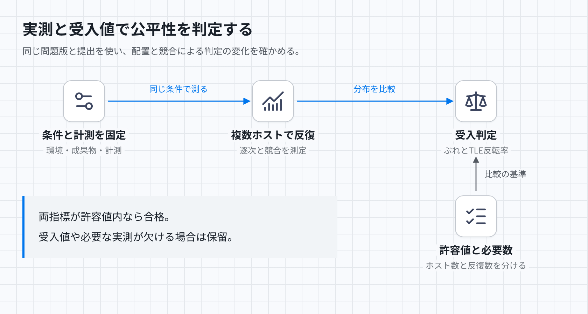

# 判定時間の公平性

## 目的

同じ問題版と提出を繰り返したとき、配置先や同時実行の違いで時間制限超過の判定が許容範囲を超えて変わらないことを確かめる。時間制限超過をTLEと呼ぶ。公平性の成立は、環境の固定、時間計測の正しさ、測定したぶれの受入判定をすべて必要とする。

[図のHTML](../diagrams/fairness.html) · [暗色PNG](../diagrams/fairness-dark.png)

## 判定に与える環境と観測

入力にはCPU型、命令セット、SMTの有無と割当て、CPU固定、同居処理、VM数、同時実行数、メモリ割当てを含める。比較対象の環境、CPU時間のぶれの計算方法と許容値、TLE反転率の定義と許容値、時間制限からの余裕、必要なホスト数と反復数も与える。SMTは一つの物理コアを複数の論理CPUで共有する方式である。カーネル、VMM、イメージ、コンパイラ、ライブラリ、実行オプション、問題版と生成バイナリも版またはハッシュで固定する。Nixなどの固定定義を使う場合も、実際に使った成果物の一致を確認する。バージョン名の一致だけでは足りない。

観測には各反復のCPU時間、実行中の実時間、待ち時間、判定、停止理由を残す。計測API、分解能、監視間隔、集計対象、計測区間も入力にする。整数演算、メモリアクセス、子孫への計算分割を含む同一の入力を使う。ホスト数と反復数を分け、逐次実行、競合のある実行、CPU型や配置先が変わる場合の分布を比較する。同じVMの反復数を独立したホスト数と数えない。

## 計測と判定の規則

判定CPU時間は、提出の全スレッドと子孫プロセスのuser時間とsystem時間の合計とする。終了済みの子も一度だけ含め、子の生成や再親化で計測を逃れられない。コンパイル、採点、キュー待ち、VM起動、結果配送は提出の判定CPU時間へ加えず、それぞれ記録する。

CPU上限と比較する計測値について、実行中の監視と終了後の集計の整合性を確認する。上限超過の比較条件、計測誤差、監視遅延を含む停止規則を固定する。実時間の監視打切りはCPU超過の証拠にはならない。VM喪失、計測不能、基盤過負荷が疑われる打切りは基盤異常として扱い、TLEにしない。原因不明なら正常な判定を確定せず、再試行または基盤失敗へ進める。

## 維持する不変条件

同じ受入判定で環境条件や計測規則を混ぜない。計測規則を満たしたうえで、定義済みの条件で必要数を測定し、CPU時間のぶれとTLE反転率がともに許容値を満たした場合に合格とする。受入値や測定数が欠ける場合は判定を保留する。CPU固定や同時一実行だけで公平性を成立としない。SMTの隣接スレッド、他VM、ホスト処理によるCPU・メモリ帯域の競合も測定条件に含める。CPU差を補正するなら補正式と検証結果が必要となる。平均値が近くてもTLE境界の反転を見落とさない。

## 反例と期待結果

- 親だけを計測して子二つへ計算を分けるとCPU時間が減る計測器は不合格となる。
- 同じ計算でもキュー待ちだけが伸びた場合、提出の判定CPU時間とTLEは変わらない。
- CPU時間を取得できず実時間上限で止まった場合、TLEではなく基盤異常となる。
- 同じ提出が同じ閾値で完了とTLEに分かれた場合、反転率を記録し、定義済みの受入値と比較する。

## 未定義・未検証事項

判定は保留である。CPU時間のぶれとTLE反転率の定義と許容値、境界からの余裕、必要なホスト数と反復数は未定である。これらの受入値と本番候補の実測がないため、合格とは判定できない。[過去の実測](../fairness-experiment.md)ではgVisor内の取得CPU時間が10 ms刻みとなり、同じ閾値で判定が混在した。Lambda MicroVMsでもメモリ中心の計算に変動が残った。これは各測定構成の結果であり、[現在のFirecracker候補](../aws-judge-orchestration.md)の合格証拠にはしない。同じ計測器と環境条件での再測定が必要となる。
