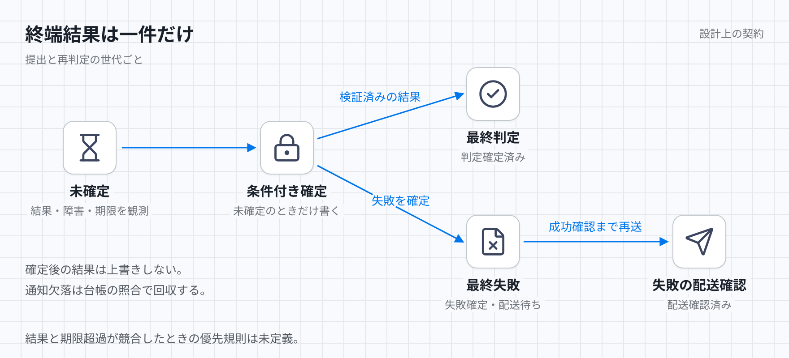

# 判定の終端確定

受理した提出を識別する`submissionId`と再判定を区別する世代`generation`の組ごとに、一件の最終判定か最終失敗へ収束する。最終失敗は失敗キューへの配送まで追跡する。プログラムの再実行と失敗通知の重複配送は許す。本書は設計上の契約であり、未定義の入力列は審査保留とする。

[図のHTML](../diagrams/judgement-completion.html) / [ダーク版](../diagrams/judgement-completion-dark.png)

## 状態と入力

台帳は起動待ち、実行中、確定処理中、判定済み、失敗配送待ち、配送確認済みを区別する。終端結果は最終判定か最終失敗の一件であり、未確定からだけ作れる。失敗配送待ちも失敗自体は確定済みで、配送確認済みはキューへの送信成功を確認した状態である。

台帳は問題版、入力参照、受付時の絶対期限、実行とジョブの参照を保持する。失敗には理由と配送待ちを保持する。入力事実は、起動応答、実行とジョブの状態、検証済み結果、障害、期限の到来、配送応答、定期照合で得た状態である。通知は同じ事実の重複や遅延を含む。

## 確定と再試行

試行は実行の一回分を指す。監督処理は結果形式と成功した試行の成果物を検証し、共通の条件付き確定処理を呼ぶ。誤答、コンパイルエラー、時間超過、実行時エラー、メモリ超過は判定結果である。管理プログラムの異常、仮想マシンの起動不能、成果物不備は再試行か最終失敗の対象とする。ジョブの成功だけでは判定を確定せず、フロー内の処理の失敗だけでも提出全体を失敗にしない。

確定処理は未確定という条件をトランザクションで検査する。成功、失敗、期限超過が競合しても終端結果を上書きしない。確定応答の消失後は保存済み結果を返す。ワーカーは終端を書けず、遅延した古い試行も確定済み結果を変えられない。

ジョブとフローの再試行は有限回とし、受付時の絶対期限を延長しない。提出プログラムの開始前に管理プログラムが世代、終端状態、期限を台帳で確認する。期限切れ、確定済み、確認不能なら開始しない。未確定のまま期限を過ぎた提出は、照合処理が失敗の確定対象にする。

最終失敗は、理由、入力、問題版、実行とジョブの参照、配送待ちを一つのトランザクションで保存する。配送処理は成功応答まで配送待ちを残して再送する。送信済みでも応答が消失すれば重複配送を許す。キューの保持期間後も失敗台帳と入力参照を保持する。

## 停止からの回復と進行前提

定期照合は起動待ち、非終端、期限超過、未配送を台帳から列挙する。起動処理は保存済みの名前と入力で既存実行を照会し、起動応答の消失を回収する。監督処理と照合処理は実行とジョブを照会し、保存済み結果の回収か同じ失敗確定処理へ進む。照合処理は停止、時間切れ、強制終了した実行も対象にする。

監督処理が停止しても照合処理が回収する。ワーカーの停止後は有限回の再試行、失敗、または期限超過へ進む。アプリと全ワーカーの再起動後も台帳から再開し、メモリや通知の再配送だけに依存しない。終端後も取消しの成功を仮定せず、既知または探索で見つけたジョブを停止確認まで追跡する。

収束には、保存・照会・更新と失敗キューが復旧すること、必要な権限と参照データが残ること、定期照合と配送再試行が対象を取りこぼさず継続することが必要である。確定と配送待ちの原子性も必要になる。期限前にワーカーを確保できなくても、期限後の失敗配送で収束できる。ワーカーの供給回復は収束の前提に含めない。

## 入力列と期待結果

各行は、一提出の当該世代が未確定の状態から始める。

| 入力列 | 期待結果 |
| --- | --- |
| 最終判定が確定し、応答が消失し、同じ確定要求を再送する | 保存済み結果を返し、結果は一件のまま。 |
| ワーカーが結果を残さず停止し、全プロセスが再起動し、期限を過ぎる | 台帳の照合から最終失敗を確定し、配送を追跡する。 |
| 監督処理が強制停止し、終端通知も欠落し、照合が実行の停止を観測する | 結果の回収か最終失敗へ進む。永久に非終端なら不適合。 |
| ワーカー不足で一度も起動せず、期限を過ぎる | 照合処理が失敗を確定し、復旧したキューへ配送する。 |
| 失敗確定後に送信処理が停止し、再起動する | 配送待ちを再送する。失敗台帳だけで完了扱いにしたら不適合。 |
| キューが受信し、応答が消失し、再送する | 重複を許し、成功確認後に配送確認済みへ進む。失敗結果は一件。 |
| 最終失敗の確定後に、古い試行の成功結果が届く | 最終失敗を維持する。 |
| 期限直前に結果を得て、確定前に期限を過ぎ、期限超過処理と競合する | 一件性は必須。どちらを採用するかは未定義で審査保留。 |

## 未確定な規則

期限判定に用いる時計と判定時点、結果回収と期限超過の優先規則は未定義である。確定処理中の状態へ入る条件と出る条件、再試行回数と各時間上限、照合間隔も未確定であり、具体値を要する時間内の収束は審査できない。確定と配送の一件性だけでは、これらの入力列の採用結果や完了時間を証明できない。
