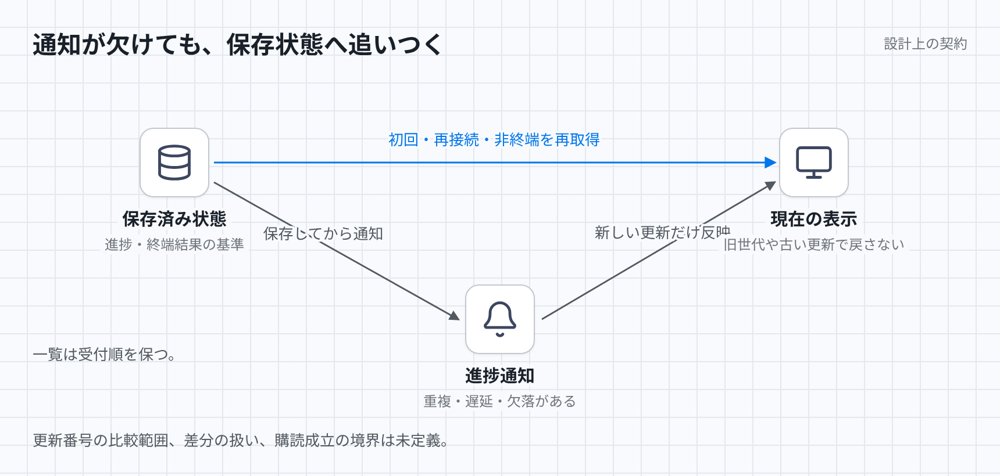

# 進捗と結果表示の契約

表示は保存済みの提出状態を基準とし、通知を取りこぼしても終端結果へ追いつく。通信方式や保存先の選定には依存せず、実装済みという主張はしない。

[図のHTML](../diagrams/progress-results.html) / [ダーク版](../diagrams/progress-results-dark.png)

## 入力と保存状態

入力は提出一覧、進捗通知、保存状態のスナップショット、初回購読、再接続、再取得の契機である。通知は、提出を識別する提出ID、再判定世代、フロー内の処理を識別するノードID、試行、更新番号を持つ。表示側は現在の世代、進捗、適用済み更新番号、一時保存した通知を保持する。

提出一覧は受理順の番号で並べる。実行順、完了順、通知到着順で並べ替えない。世代は再判定を区別し、試行は同じノードの再実行を区別する。更新番号は新旧と重複の判定に使うが、比較できる範囲は未定義である。

## 更新規則と不変条件

進捗は保存してから通知する。通知は保存済み状態を伝える手段であり、終端結果を新たに確定する入力ではない。重複や古い通知によって表示を戻さず、別の提出や旧世代の通知を現在の進捗へ混ぜない。

初回と再接続時はスナップショットを取得する。購読中の通知を一時保存し、スナップショットより新しい更新だけを適用する。接続を維持していても、非終端の提出は再取得する。終端通知が失われた場合にも、この再取得で保存済み終端結果へ追いつく。収束には再取得の継続と保存状態の読み取り成功が必要である。許容遅延と再取得間隔は未定義である。

## 入力列に対する期待結果と不足する規則

提出を順に受理し、後の提出が先に完了する。一覧の受理順は変わらず、それぞれの行に対応する結果を表示する。

同じノードと試行の更新番号8、7、8が順に届く。期待する結果は8の内容を一度だけ反映し、7へ戻さないことである。ただし、更新番号が提出全体、ノード、試行のどれに対して増えるかは未定義である。別ノードの更新を同じ番号だけで捨ててよいとは判定できない。

更新番号8の差分が「ケースを一つ追加」、9の差分が「別のケースを一つ追加」で、9だけ届いた後に8が届く。新しい番号だけを適用すると一方のケースが消える。通知が全状態か差分か、差分の欠落・逆順をどう扱うかが未定義なので、この入力列の正しい更新規則は判定できない。

初回取得の読み取り中に更新が保存され、購読成立前に通知が通過する。スナップショットが更新前なら表示は古いままである。購読成立の確認点、通知の一時保存を始める時点、スナップショットと更新番号の整合性が未定義なので、初回取得だけで欠落を防げるとは判定できない。

接続中に終端結果が保存され、最後の通知だけ失われる。期待する結果は再接続を待たず再取得で終端を表示することである。再取得を停止したまま非終端を表示し続ける動作は契約違反である。

新世代の表示後に旧世代の終端通知が届く場合、その通知では現在の表示を変えない。新しい試行の表示後に古い試行が成功した場合の採用規則と、再取得したスナップショット自体が古い場合の扱いは未定義であり、世代・試行・更新番号があるだけでは正しさを判定できない。
