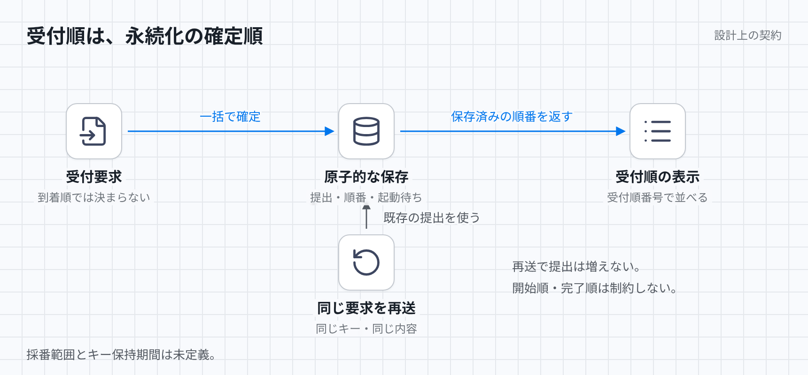

# 提出の受付順

受付成功は提出と順番の永続化を意味する。実行の開始順と完了順は制限しない。本書は[現案](../aws-judge-orchestration.md)の契約であり、実装済みの保証ではない。

[図のHTML](../diagrams/submission-order.html) / [ダーク版](../diagrams/submission-order-dark.png)

## 状態と入力

保存状態は、採番範囲ごとのカウンター、提出、冪等キーと提出の対応、起動待ちである。提出には受付順受付順番号、問題版、不変な入力参照、絶対期限を含める。受付確定後は起動待ちとして記録する。

入力は、受付要求、その再送、永続化の成否、受付応答の到達か消失である。要求は、同じ要求の再送を識別する冪等キーと内容を持つ。同じキーの再送かどうかは、保存済みの対応から判断する。通信の到着順やAPIのメモリだけでは決めない。

## 処理規則と不変条件

受付処理は、同じ範囲のカウンター更新、提出、冪等キー、問題版、入力参照、期限、起動待ちを一つのトランザクションで確定する。一部だけを受理済みにしない。同時受付の順番は確定順とする。同じ範囲の異なる提出に同じ順番を割り当てない。欠番の有無は現案の保証に含まれない。

同じキーと同じ内容の再送には既存の提出と順番を返す。新しい提出や起動待ちを増やさない。確定応答が消失した場合も、この規則を使う。確定前に停止した要求は、再送後の確定順で受け付ける。UIは受付順番号で表示するが、実行処理は後の提出を先に開始、完了できる。

保存処理には、上記トランザクションの原子性、確定済み対応の永続性、競合するカウンター更新の直列化が必要である。再送を判定する間は冪等キーと内容を照合できなければならない。受付後の起動は永続化した起動待ちを参照し、通知欠落時には定期照合で回収する。受付順は通知の再配送順に依存しない。

## 入力列と期待結果

各行は空の範囲から始める。内容が同じと書いた行は、同一の内容として比較できる場合に限る。

| 入力列 | 期待結果 |
| --- | --- |
| 同じ範囲の二提出が同時到着し、後着側が先に確定する | 先に確定した提出の順番が小さい。到着順を返したら不適合。 |
| 受付が確定し、応答が消失し、同じキーと内容で再送する | 提出は一件で、既存の順番を返す。 |
| 確定前にAPIが停止し、別提出が確定し、停止した要求を再送する | 再送した要求の順番は、先に確定した別提出より後になる。 |
| 二提出を受理し、後の提出が先に完了する | 適合。表示する受付順は変わらない。 |
| 受付後、同じキーで異なる内容を送る | 拒否、既存提出の返却、別提出の受理のどれかは未定義。審査保留。 |

## 未確定な境界

採番範囲をユーザー、コンテスト、問題、全体のどれにするかは未定義である。異なる候補範囲から同時に送った二提出を比較できるかは審査保留となる。冪等キーの有効範囲、保持期間、内容比較の対象と正規化も未定義である。キーを保持期間後に再送した列、参照先だけを変えた列の受理結果も審査保留である。
