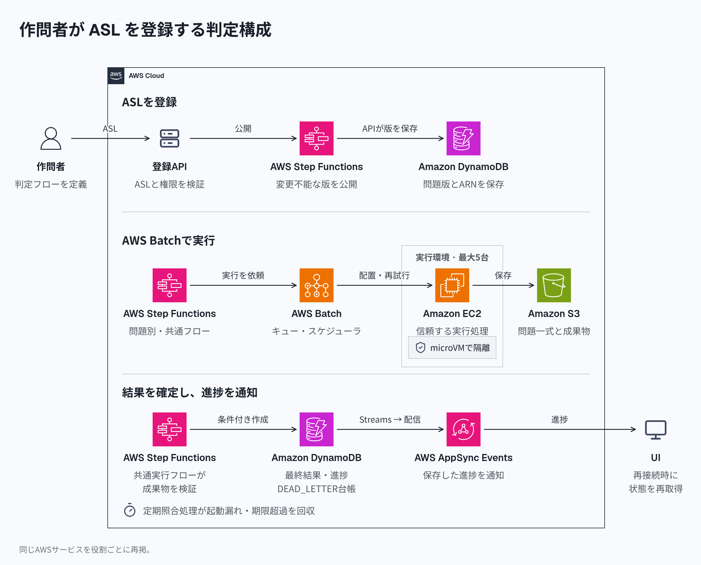

# 作問者のASLをStep FunctionsとAWS Batchで実行する構成

作問者が判定フローをAmazon States Language（ASL）で登録し、Step Functions Standardが分岐と処理の依存関係を管理する。AWS Batchがジョブの保持・配置・再試行を担い、EC2上のmicroVMがプログラムを実行する。問題ごとのリポジトリやインフラ定義の変更は不要になる。

[HTML版](../diagrams/native-asl-batch.html)・[暗色版](../diagrams/native-asl-batch-dark.png)

## フローの登録と版固定

作問者はASLと、テスト・採点プログラム・実行スクリプトをまとめた問題一式を登録する。登録APIは[AWSの構文検証API](https://docs.aws.amazon.com/step-functions/latest/apireference/API_ValidateStateMachineDefinition.html)に加え、呼び出し先、時間、並列数、入出力、権限と資源上限を検証する。問題別のStandardステートマシンを作成・更新して[変更不能なバージョン](https://docs.aws.amazon.com/step-functions/latest/dg/concepts-state-machine-version.html)を公開し、問題の版にバージョンARNと問題一式のハッシュを保存する。提出はその版に固定する。

作問者は`Choice`、`Parallel`、`Map`、`Wait`、`Retry`、`Catch`と接続関係を定義する。`Task`の呼び出し先は共通の実行フローに限る。このフローは固定キュー・ジョブ定義に[`batch:submitJob.sync`](https://docs.aws.amazon.com/step-functions/latest/dg/connect-batch.html)で投入し、成功した試行のS3マニフェストを検証する。Batchの完了応答だけでは判定結果を確定しない。ホストコマンド、IAMロール、キュー、ジョブ定義は作問者に選ばせない。

## 受付と実行

受付APIは、採番範囲内のカウンターの条件付き更新、提出、冪等キー、`START_PENDING`を[DynamoDBのトランザクション](https://docs.aws.amazon.com/amazondynamodb/latest/developerguide/transaction-apis.html)で保存する。`submissionSeq`はコミット順とし、画面もその順に表示する。実行順は問わない。入力と試行別の成果物はS3に置く。

Streamsを受けるLambdaが判定IDと再判定世代`generation`から固定名と入力を作り、判定全体の監督用フローを開始する。監督用フローは問題別フローを`.sync:2`で待つ。[`StartExecution`](https://docs.aws.amazon.com/step-functions/latest/apireference/API_StartExecution.html)は実行中の同名・同一入力には冪等だが、終了後は`ExecutionAlreadyExists`となり、90日後には名前を再利用できるため、起動状態も台帳に残す。

Batchが仕事の分担を担い、EC2停止を含む失敗を[設定回数まで再試行](https://docs.aws.amazon.com/batch/latest/userguide/job_retries.html)する。アプリ側に実行権の管理、リーダー選出、常駐マスターは置かない。アプリやワーカーが再起動しても、進行状態はStep FunctionsとBatchに残る。

## 一度だけの確定と障害回復

プログラムの物理的な再実行は許容し、`(submissionId, generation)`の最終結果だけを条件付きで一度作成する。WA・CE・TLEは正常な判定結果として基盤障害と区別する。実行機に最終結果の更新権限は与えず、ジョブID・試行別S3パスで成果物を分離する。成功と期限切れが競合しても、一方だけを確定する。

SQSは使わない。回復できない失敗はDynamoDBの`DEAD_LETTER`台帳へ確定し、理由、入力参照、フローの版、実行参照を再判定のために残す。

[Batchの`RUNNABLE`は無期限に滞留し得る](https://docs.aws.amazon.com/batch/latest/userguide/job_states.html)。[Batchのタイムアウトは`STARTING`を含まない](https://docs.aws.amazon.com/batch/latest/userguide/job_timeouts.html)ため、受付時に全体の絶対期限を固定する。独立した定期照合処理が、起動漏れ、フローの失敗・停止、期限超過を同じ確定処理で回収する。

[Streamsの保持は24時間](https://docs.aws.amazon.com/amazondynamodb/latest/developerguide/HowItWorks.CoreComponents.html)で、[Step FunctionsのEventBridge通知](https://docs.aws.amazon.com/step-functions/latest/dg/eventbridge-integration.html)と[同期統合のキャンセル](https://docs.aws.amazon.com/step-functions/latest/dg/connect-to-resource.html)は成功を保証しない。通知から独立した照合と残存ジョブの回収が必要になる。最終的な終端にはAWSの復旧、照合の再開、権限とデータの保持を前提とする。

進捗は判定ID・世代・タスクID・試行・通し番号とともにDynamoDBへ保存し、[AppSync Events](https://docs.aws.amazon.com/appsync/latest/eventapi/event-api-concepts.html)で通知する。UIは初回・再接続・定期取得でスナップショットを読み、重複や古い試行を除外する。

## 隔離と運用上の制約

提出、コンパイラ、採点プログラムはmicroVM内で実行し、AWS資格情報、インスタンスメタデータ、ホストのファイルシステム、外部ネットワークへのアクセスを渡さない。信頼する実行管理プログラムが入出力と資源制限を担い、[ECSコンテナだけを隔離境界にしない](https://docs.aws.amazon.com/AmazonECS/latest/developerguide/task-iam-roles.html)。[ネストされた仮想化に対応するEC2](https://docs.aws.amazon.com/AWSEC2/latest/UserGuide/amazon-ec2-nested-virtualization.html)でも、KVMとの統合と[Firecrackerのホスト設定](https://github.com/firecracker-microvm/firecracker/blob/main/docs/prod-host-setup.md)は実装・運用の責任として残る。Batchのタイムアウトは最短60秒なので、細かな判定時間制限は実行管理プログラムが実装する。

最大5台の候補は、単一インスタンスタイプ、On-Demandの`BEST_FIT`、`maxvCpus`を1台分のvCPU数の5倍にする設定である。[`BEST_FIT_PROGRESSIVE`などは最大1台分超過し得る](https://docs.aws.amazon.com/batch/latest/APIReference/API_ComputeResource.html)。`BEST_FIT`のインフラ更新制約に従い、計算環境の交換時も新旧合計を5台以内に管理する。

対象リージョンでのBatch・KVM・Firecrackerの組み合わせ、攻撃耐性、障害回復、台数上限、起動時間、公平性、進捗遅延、処理能力、費用、クォータ適合は実機未検証である。
