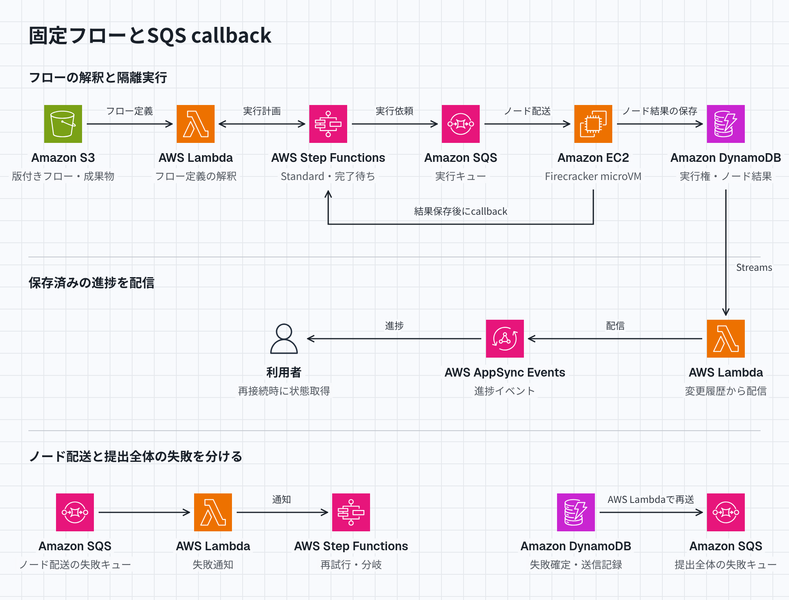

# 固定ワークフローとSQS callbackによるオンラインジャッジ

Step Functions Standardの固定ワークフローが、作問者のフローを独自の記述言語で受け取り、SQS経由でEC2ワーカーへ採点を依頼する。問題ごとのリポジトリやインフラ定義の変更は不要になる。

[HTML版](../diagrams/sqs-callback.html) · [ダーク版](../diagrams/sqs-callback-dark.png)

## 登録したフローを固定エンジンで動かす

作問者は版付きJSONなどで、処理ノード、依存関係、条件分岐、上限付き並列処理、プログラムと入力への参照を登録する。初期範囲は有限の有向非巡回グラフとし、反復を追加するなら回数と時間を制限する。採点開始時にフロー、問題データ、コンパイラ、採点プログラムの版を固定する。

フローの構文検証、解釈、依存解決を担う`PlanNext`は独自実装である。実行可能なノードを選び、[SQS callback連携](https://docs.aws.amazon.com/step-functions/latest/dg/connect-sqs.html)でワーカーの完了通知を待って次へ進む。大きな状態はS3かDynamoDBへ置き、[入出力256 KiB、実行履歴25,000件の上限](https://docs.aws.amazon.com/step-functions/latest/dg/sfn-best-practices.html)を考慮する。

## 受付順と実行権をデータで管理する

受付順はコミット時の連番とし、実行順は制約しない。[DynamoDBトランザクション](https://docs.aws.amazon.com/amazondynamodb/latest/developerguide/transaction-apis.html)でカウンターの条件付き更新、`submissionSeq`付き提出、冪等キー、起動依頼の送信待ち記録を保存する。競合時は読み直して再試行する。起動漏れは記録の定期照合と再送で修復し、応答消失には[固定した名前と入力での起動](https://docs.aws.amazon.com/step-functions/latest/apireference/API_StartExecution.html)と永続台帳を併用する。

空き枠のあるワーカーが同じSQSキューからメッセージを取得する。[重複配送](https://docs.aws.amazon.com/AWSSimpleQueueService/latest/SQSDeveloperGuide/standard-queues-at-least-once-delivery.html)があるため、visibility timeoutを排他ロックにしない。ノードごとに判定ID、ノードID、試行ID、担当ワーカー、実行権の期限`leaseExpiresAt`、世代番号`fencingEpoch`を保存し、条件付き更新で取得する。

実行中は実行権とvisibility timeoutを延長し、引き継ぎ時に世代番号を増やす。古い世代の進捗、成果物採用、結果保存を拒否する。分断した旧ワーカーの物理実行までは止めない。callback待ちは有限期限とし、キュー待機中にも進む短いheartbeat期限をワーカー死亡判定に流用しない。

## 結果確定と失敗配送を分ける

ワーカーはS3へ成果物を保存し、DynamoDBへノード結果を確定してからcallbackする。再配送時は保存済み結果を再利用する。AC、WA、CE、TLEは正常な採点結果として扱う。

物理的な再実行は許容するが、判定の未終端条件を付け、最終判定を一度だけ確定する。再試行上限に達したら、最終失敗と、判定全体の失敗キューへの送信待ち記録を同じトランザクションで保存する。DynamoDBとSQSの同時確定は前提にせず、未送信分を再送し、重複を判定IDで識別する。

ノード配送用の失敗キューは配送の失敗を受け、仲介処理がワークフローへ通知する。フロー内の再試行や代替処理が可能であり、判定全体の失敗とは区別する。[SQSの保持は最大14日](https://docs.aws.amazon.com/AWSSimpleQueueService/latest/SQSDeveloperGuide/creating-sqs-fifo-queues.html)なので、失敗履歴と再実行入力はDynamoDBとS3にも残す。

## 停止後は保存状態から回復する

結果保存前のワーカー停止は実行権とvisibility timeoutの満了後に引き継ぐ。保存後の停止は結果を再利用してcallbackを再送し、callback後の再配送も再採点しない。`PlanNext`の操作は冪等にして再試行する。ワークフローの未処理例外や全体の時間切れは修復処理が保存結果を回収するか失敗確定する。

常駐マスターは置かず、全ワーカー再起動にもAWS側の保存状態から復帰する。判定または失敗に至る保証は、AWSの復旧と修復処理の再開を前提とする。

## 隔離と運用上の条件

初期構成は2 AZに1台ずつ置き、EC2の上限は5台とする。滞留と枠利用率で増減し、縮退時は処理中の保護と新規実行停止を行う。置換中も5台を厳守するなら、`MaxSize`に加えて[再配置時の一時的な上限超過](https://docs.aws.amazon.com/autoscaling/ec2/userguide/auto-scaling-benefits.html)も制約する。

提出、採点プログラム、テスト生成器、コンパイルは毎回新しいFirecracker microVMで実行する。ゲストにNIC、AWS資格情報、完了通知用のタスクトークン、ホストのファイルを渡さず、CPU、メモリ、時間、出力、ディスクを制限する。[ホストの隔離設定](https://github.com/firecracker-microvm/firecracker/blob/main/docs/prod-host-setup.md)を保守し、比較用正解データと判定確定処理は信頼する側に置く。[対応EC2のネスト仮想化](https://docs.aws.amazon.com/AWSEC2/latest/UserGuide/amazon-ec2-nested-virtualization.html)でKVMを使う案である。

進捗は保存後にAppSync Eventsへ配信し、判定ID、ノードID、更新番号で重複と旧状態を除く。再接続時と低頻度の再取得で通知漏れを補う。

実機では未検証である。フロー定義の上限、受付競合、KVM統合、採点時間の再現性と公平性、資源制限、各期限と再試行値、応答消失や旧ワーカー復帰への耐性、台数制御、費用、サービス上限、進捗遅延を検証する必要がある。
