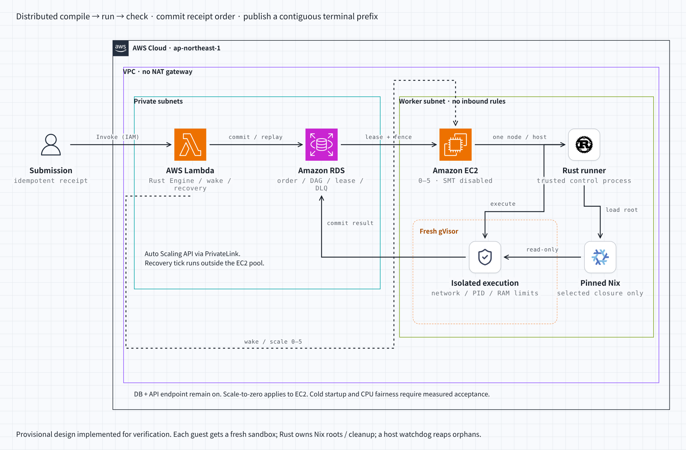

# PostgreSQL queue / EC2 pool の最小実証

2026-11-02、`codex-judge-fairness`。起点は `develop-hayatroid` の
`d2400cb752ee3354099844627eb0df390d38d7c5`。構成・実装とも仮置き。PRは作成しない。

**分散ノード、PostgreSQL、最大5台のEC2、Rustによる固定Nix環境のload/cleanup、durable eventの組合せは動いた。ただし要求全体への適合は未達。**
scale zeroからの結果到達は180〜199秒で10秒目標を満たさない。
公平性は短い計算fixtureのCPU時間でCV約5%あり、受入基準も未確定。
同時受付のロック競合と実機障害注入の失敗も残る。



[操作可能なHTML](diagrams/postgres-pool.html) / [dark PNG](diagrams/postgres-pool-dark.png)。
図は [caru-ini/stack-diagram](https://github.com/caru-ini/stack-diagram)
`9413ef2b611bb695cb969913c829beda828affaf` のtemplate・icons・rendererを使用。
生成元は [postgres-pool-diagram.py](../../infra/scripts/postgres-pool-diagram.py)。

## 構成と実証範囲

- 既存workflow Engineのcompile → run → checkを別々の分散ジョブにする。今回は提出あたり1ケース。
- PGに受理receipt、scope内連番、DAG、lease、結果、DLQ、eventを保持する。同じ提出UUID・内容で再送できる。
- `SKIP LOCKED`によるclaim、30秒lease、token/期限による古い結果の拒否、最大3試行、提出全体5分の期限。
  pool外のLambdaと1分tickが復旧・起動を継続する。通信失敗で未受理の提出まで保存を保証しない。
- EC2 ASGはmin=0 / max=5。c7i.xlargeのSMTを無効にし2core / 1thread。
  1台同時1ノード、trusted controlはCPU 0、判定sandboxはCPU 1。xlarge全体の料金がかかる。
- private RDS PostgreSQL 17.11。初回はSingle-AZ・backupなし、V2はMulti-AZ・backup 7日。
  Auto Scaling APIのPrivateLinkを1 AZに置き、NATは使わない。
- Rustが固定Nix closureだけをread-onlyで渡し、ノードごとに新しいgVisor sandboxを作成・回収する。
  GCC 15.2.0 / Python 3.13.12 / Rust 1.94.1。提出をNix式として評価しない。
- artifactは実証では上限付きでPGに保持。S3は検証用収集物・tools用。大量ケース、保存期限・容量設計は残る。
- 入口はIAMによるLambda Invoke。一般利用者向け認証・HTTP/SSE・UI・scoreboardは未接続。

## ordering / progress / result

受理時にscope内の連番をTXで確定する。実行・完了順は自由。
現在の仮実装は**最終結果の公開も受理順の連続したprefixに揃える**。
先の提出が遅れると後の結果公開も待つ。公開順まで揃えるのか、一覧・スコアの反映順だけでよいかは未確定。
一覧を並べるだけの要件なら、この公開待ちは不要であり10秒目標にも不利になる。

進捗と結果は別event。受理、workflow/job状態、queued/started/finished/deadletteredを状態変更と同じTXのoutboxに記録し、公開時に`result.published`を一度記録する。
後続提出の進捗は先に届いてよい。結果表示の確定は`result.published`を使う。
[実際の1提出のevent列](postgres-pool-data/event-example.json)を収録した。

outbox identityをclient cursorには使わない。小さいidentityのTXが後からcommitしうるため、未配送行をdispatchし、scopeのstream行ロック下で別cursorを採番する。
clientは`(scope, after)`で最大256件ずつ再取得する。同じcursorの再取得を許容し、clientでも重複適用を防ぐ。
HTTP応答のexactly-onceを保証するものではない。cursorは配送順でありjob実行順やTX開始順ではない。
負数・現在より先のcursorはエラー。保持期限、snapshot/resync API、schema versionは今後必要。

## 実機結果

[集計データ](postgres-pool-data/summary.json)はAWS識別子を除くallowlist方式。
[analyze.py](../../infra/experiments/postgres-pool/analyze.py)でprivate収集物から生成した。

| 対象 | 観測 | 判定・範囲 |
| --- | --- | --- |
| 初回の受理48件 | 36 AC、12 DLQ。初期12件はgVisor起動設定・paused sandbox削除の不具合 | 全件終端。12件を正常judge扱いしない |
| V2の受理25件 | 22 AC、1 WA、1 OLE、1 MLE、全件公開 | 1ケースfixtureでの実証 |
| V2 cold 6件、実際に0→5台 | client最終eventまで180.32〜199.45秒 | **10秒未達**。起動・転送を含む |
| V2 warm逐次6件 | DB公開1.82〜3.98秒、client最終event 8.10〜8.59秒 | 軽いfixture、IAM Invoke＋status/event polling。UIのSLOではない |
| 5件同時受付 | 一部がscaler/admissionのlock待ち5秒で`55P03` | **未合格**。同じUUIDで手動再送後は5件AC。手動待ちをlatency集計から除外 |
| event再接続 | 700件、cursor 1〜700、最終結果25件、重複なし、受理順 | この有限の試行で確認 |
| network fixture | IMDS・外部443に接続不可、DB/AWS環境変数・Docker socketなし | sandbox内からの到達を確認 |
| process fixture | 150 fork要求が制限で停止 | guest nproc=64、host pids制限も設定 |
| output / byte checker | 1 MB出力がOLE、invalid UTF-8がWA | replacement文字による誤ACを防止 |
| memory fixture | 512 MB上限で実際にMLE、直後の通常提出AC | cgroup OOMを確認。DLQを成功条件にしない |
| AWS worker障害 | 2回の停止トリガが実行中に発火しなかった | **未検証**。`worker-loss*`のACは障害回復の証拠ではない |
| DB failover / restore | Multi-AZ・backup 7日を設定 | **切替・復元は未実施** |

warm計測中は終了をsuspendして5台を保持した。課金されるwarm容量でありscale zeroのlatencyではない。
idle時desired=0とcleanup時の終了は確認したが、通常運用の継続的な自動scale downの負荷試験は残る。

### 公平性

同じ80M回の計算を5回ずつ測定したhost cgroup CPU時間。並行時も各EC2は同時1ノード。

| 条件 | median | min〜max | CV |
| --- | --- | --- | --- |
| 逐次5回 | 160,868 µs | 153,348〜178,380 µs | 5.23% |
| 並行要求5回 | 161,696 µs | 156,082〜180,167 µs | 5.02% |

長い同一fixtureの別測定20回は2.488〜2.949秒、median 2.566秒、CV 4.55%、すべてAC。
3秒境界を跨ぐ較正ができておらず、TLE反転頻度の検証にはなっていない。サンプル数も不足し、合格とは扱わない。

host cgroup全体のCPU予算3秒を2 ms間隔と停止後の最終値で確認する。
gVisor Sentryの処理も含み、提出processだけのCPU時間とは異なる。
5秒wall watchdogは基盤側retry対象とし、CPU TLEに置き換えない。
SMT無効・affinityでも物理host競合や機種内差は消えない。
native同一機種比較、長期間・複数host、cache/memory負荷、言語別基準、境界判定反転は未検証。
gVisorだけを原因と断定する根拠もない。

## チェックリスト

| 要件 | 根拠・確認済み | 残る穴 |
| --- | --- | --- |
| ordering | 実PGの逆順完了→受理順公開、実機25件 | scope/scoreboard semantics、公開待ちの必要性 |
| durable acceptance | receipt先行commit、同UUID再送、DAG検証、job ID衝突防止 | 曖昧commit応答・client再送を含む実機断線 |
| durable jobs | lease/attempt/token fence、replay、deadline、PG DLQ | 実機worker消失、partition、長期停止 |
| durable storage | V2 Multi-AZ＋backup設定 | failover/restore、RPO/RTO、DB障害時の表示 |
| progress / result | TX outbox、別cursor、paging/replay、公開一度 | UI、client冪等適用、認可、保持期限/resync、複数ケース集計 |
| isolated execution | 新規gVisor、network none、nonroot、capsなし、no-new-privileges、RO root/closure | kernel/runtime exploitへの保証ではない。upgrade運用、脱出試験 |
| resource limits | CPU/memory/pids/nproc/nofile/tmpfs/output制限、bomb fixture | mixed abuse、cache/I/O、host disk蓄積、長期的な回収率 |
| cleanup | unpause→remove、host watchdog、atomic deadline、precreate残骸reap | AWSでworker停止した際の実回収 |
| zero→10秒 | cold測定済み | **未達**。現bootstrapでは両立しない |
| fairness | SMT無効、CPU affinity、同時1ノード、固定toolchain、分布測定 | **未合格**。許容値と境界試験 |
| max5 / cost | ASG max5、料金表、実験resource削除確認 | admission/scaler lock分離、負荷制限、容量制御 |

## fresh review

背景を継承しないfresh subagent 2名が読み取り専用でレビューし、後者は全体を再読した。
実装・SQL・制御・試験を対象とし、ordering / durability / isolation / event配信・再接続を確認した。

- 不正DAGでcontroller停止、復旧scanの偏り、deadlineとgraph作成競合、終端上書き：validation、round-robin scan、receipt lock、終端保護を追加。
- 小さいoutbox IDの遅延commitによるevent欠落：未配送scanと別cursor採番へ変更。
- event入口の未配線：Lambdaへ配線し実機700件replayで確認。
- stdout/stderr一方の終了待ちによる出力制限の遅延：`try_join!`で失敗時に他方も中断。UTF-8変換による誤ACも生bytes比較へ。
- 古いidle判断によるscale down：PG advisory lockと回帰試験。ただしlockが広すぎるburst失敗は未解決。DBとAWSの原子更新でもない。
- OOM試験がDLQでも成功する偽陽性：`done + MLE`必須へ変更し実機確認。
- paused gVisor削除hang、precreate残骸、watchdog競合：unpause、command timeout、atomic marker、reapを追加。
- wall timeoutとCPU時間の混同、公平性基準欠落：計測を分け、合格扱いを撤回。

最終再読で新規P1は見つからなかったが、上表の未達を解消したことにはならない。
追加DB timeout guardと子process kill/SIGSTOP試験は**AWS実証後のローカル変更**。
`ALTER ROLE SET`は次回接続から有効で既存poolへ即時反映されない。
freeze試験の300 ms設定はlock解放機構の確認であり、既定30秒の適用やAWS障害回復の証明ではない。

## 費用概算

東京、Linux On-Demand、月730時間、USD、2026-11-02のAWS Price List API。実請求額ではない。

| 項目 | 単価・前提 | 月額 |
| --- | --- | --- |
| RDS db.t4g.micro Multi-AZ | $0.050/h | $36.50 |
| RDS gp3 20 GB Multi-AZ | $0.276/GB月 | $5.52 |
| Auto Scaling API PrivateLink 1 AZ | $0.014/h | $10.22 |
| worker 0台の固定部分 | 上記合計 | **$52.24** |
| worker 1台常時warmの追加 | EC2 $0.2247/h＋24 GB gp3 $0.096/GB月＋IPv4 $0.005/h | $169.99 |
| worker 1台常時warm | 固定部分込み | **約$222/月** |
| worker 5台常時warm | 固定部分込み | **約$902/月** |
| 1台×毎日1時間、月30 worker時間 | disk/IPv4も時間比例の近似 | **約$59/月** |
| 5台×毎日1時間、月150 worker時間 | 同上 | **約$87/月** |

Single-AZ・backupなしなら固定部分は約$31.23/月だが耐障害性の推奨値ではない。
Lambda、1分tick、logs、S3、backup超過、通信、RDS CPU credit、DB容量増加は別途。
既存PG共用なら追加負荷と障害領域を含め見積もり直す。compute zeroでもPGとendpointの固定費は残る。
[Multi-AZ compute原票](postgres-pool-data/multi-az-prices.json) / [storage原票](postgres-pool-data/storage-prices.json)。

## 再現と検証

実験コードは `server/traojudge-judge-probe` と `infra/experiments/postgres-pool`。
運用APIへ未統合のprobe。実PGテストは専用DBへ書くため通常の`cargo test`ではignoreする。

```sh
source /workspace/tooling/env.sh
export DATABASE_URL='<専用ローカルPostgreSQL>'
# Python環境にはcollector-requirements.txtとboto3をinstallする。
cargo test -p traojudge-judge-probe --tests -- --ignored --test-threads=1
python -m unittest discover -s infra/experiments/postgres-pool -p test_control.py
cargo test -p traojudge-workflow -p traojudge-infra
cargo fmt -p traojudge-infra -p traojudge-judge-probe -- --check
cargo hakari generate --diff
cargo hakari manage-deps --dry-run
cargo hakari verify
npm --prefix infra run build
```

実PGで意味のある8試験、controller adapterの2試験、既存workflow/infra testsを実行した。
子process補助用のignored test自身は件数に数えない。

AWS再実験は `infra/PATTERNS.md` と環境の起動skillに従い、同名stackがあれば先に削除。
assetをdeploy前に準備し、1時間の使い捨てstackとして扱う。

```sh
cargo build -p traojudge-judge-probe
python infra/experiments/postgres-pool/prepare.py --flatten-base
uv pip install --target work/pg-pool-inspector \
  -r infra/experiments/postgres-pool/collector-requirements.txt
cp infra/experiments/postgres-pool/collect.py work/pg-pool-inspector/
cp work/pg-pool-host/rds-ca.pem work/pg-pool-inspector/
python -c "import shutil; shutil.make_archive('work/pg-pool-inspector', 'zip', 'work/pg-pool-inspector')"
cd infra
npx aws-cdk deploy --app 'npx tsx bin/postgres-pool.ts' \
  --context generation=V2 --context hardened=true --require-approval never \
  --outputs-file ../work/pg-pool-outputs.json --output ../work/pg-pool-cdk-v2
cd ..
# AWS_PROFILE=AWS / AWS_CONFIG_FILEは環境で指定。
# run.py cold,warm,burst,security,eventsを段階実行しprivateなwork/へ保存。
# faultは今回発火に失敗。全phaseが合格するharnessではない。
python infra/experiments/postgres-pool/run.py cold
# 成否にかかわらずdestroy。warm試験でTerminateをsuspendしたら必ずresume。
cd infra
npx aws-cdk destroy --app 'npx tsx bin/postgres-pool.ts' \
  --context generation=V2 --context hardened=true --output ../work/pg-pool-cdk-v2 --force
```

実機binaryと、実証後のDB guard/test追加は同一ではない。集計のenvironmentに実際に準備したimage・Nix lock・toolchain・gVisor hashを記録。再現時はsource更新後にassetを作り直す。

検証用2 stackはdestroy後、VPC、endpoint、未終了EC2、ASG、RDS、Lambda、evidence bucketの消失を個別APIで確認した。[削除確認](postgres-pool-data/teardown.json)。共有CDKToolkitは維持。
