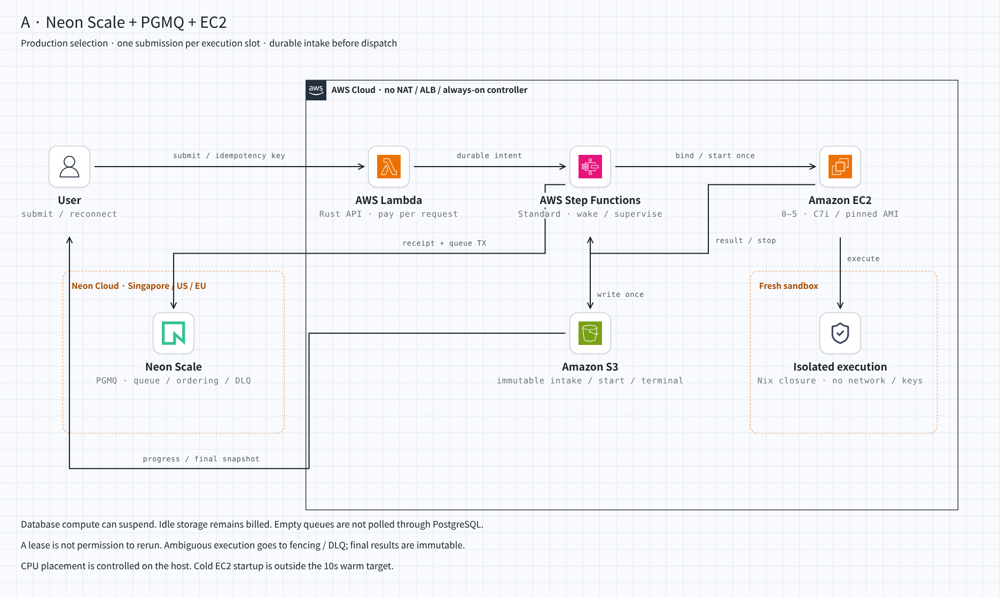
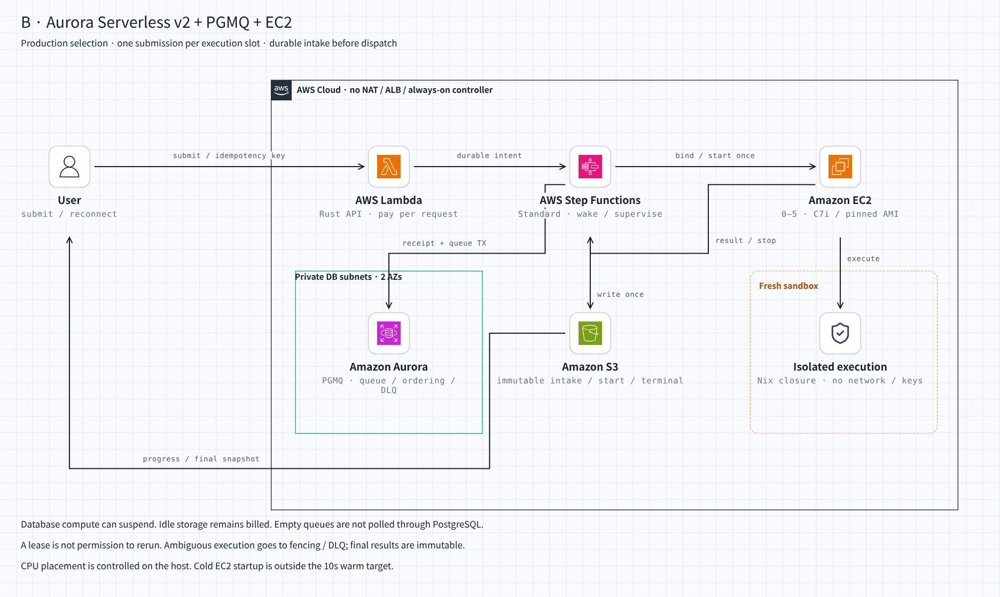
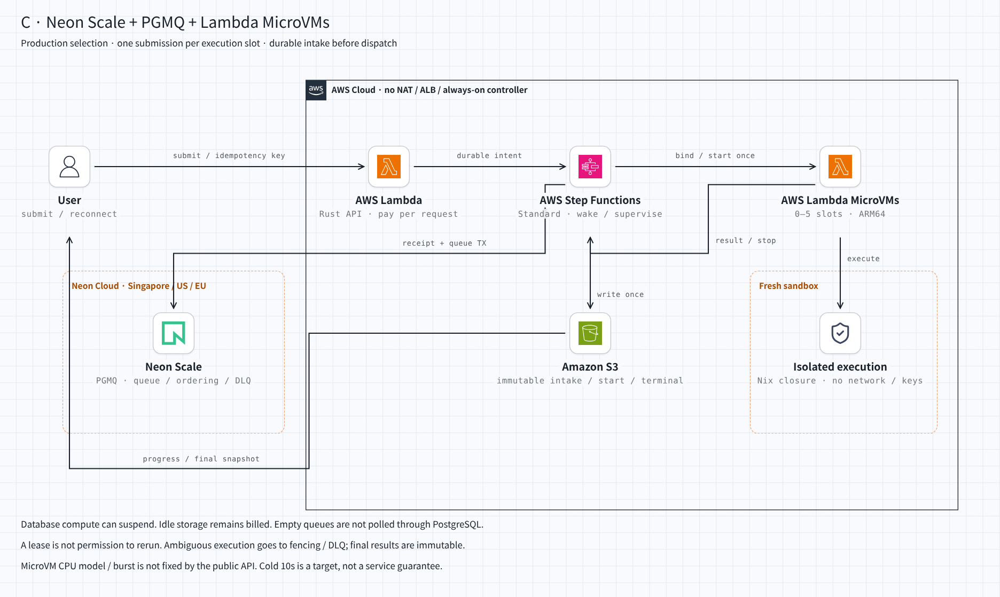

# 無提出時の固定費を抑えるproduction構成の選定

> **旧案・推奨取り下げ**：AWS内完結、作問者フローのデータ登録、自作orchestratorを増やさない要件を反映した現行案は
> [AWS judge orchestration](aws-judge-orchestration.md)。以下のNeon/PGMQ推奨は履歴として残す。
> 過去のadvisory依頼に候補・追加条件を入れており、要件だけの白紙提案として扱うべきではなかった。

2026-11-03 JST。設計・通常価格の比較であり、新しい実機PoCやdeployの報告ではない。
既存コードを前提にせず、4つのfreshなGPT-6 Astra / Max advisoryを独立に取得した。

予算の意図は、処理量にかかわらず月$10が掛かる構成を避け、必要な台数・時間に対して払うこと。
月$10をhard capにして受付を止める方針は、今回の選定条件にしない。

**無提出時は概算$1〜2/月規模まで下げられる。低利用量なら処理分込み月$10も可能。**
computeを無負荷時ゼロにできるが、永続データの保持費まではゼロにならない。
また、固定したCPU条件・EC2の0台起動・coldを含む全提出10秒・利用量無制限で月$10、の同時保証はしない。

選定する共通部分は **Neon Scale＋PGMQ＋Rust Lambda＋Step Functions Standard＋S3**。
既出のEC2条件とCPU構成の制御を優先する場合、実行基盤の推奨は **A：C7i / Firecracker、0〜5台**。
cold 10秒も優先する場合の候補はCだが、公開仕様でCPU性能を固定できず、公平性のハード要件を満たすとして確定採用できない。
この条件差を隠して「すべて適合」とは判定しない。

台数調整の予算感は以下。東京C7i xlarge、24 GB root gp3、稼働時public IPv4を含む。

| 稼働方針 | 無提出時 / 稼働費の目安 |
| --- | --- |
| 0 running / 0 stopped、必要時に起動 | 保存等だけ約$1〜2/月。通常の第一候補 |
| 0 running / 1 stopped | 上記に停止中24 GB EBS約$2.30/月を追加。再開時間の保証にはしない |
| 1台を稼働 | 約$0.23/時間＋DB等の使用分 |
| 5台を稼働 | 合計約$1.16/時間＋DB等の使用分 |
| 1台を20時間だけ事前起動 | worker部分約$4.66。大会・利用時間だけwarmにする |

停止済みworkerを5台固定で保持するとroot EBSだけで約$11.52/月になるため、idleの既定にはしない。

## 候補ごとの構成

| 案 | 構成 | 月$10の条件付き例 | 採否 |
| --- | --- | --- | --- |
| A | Neon Scale＋PGMQ＋EC2 C7i / Firecracker | 約$8.72 | EC2条件とCPU設定の制御を維持する推奨。cold 10秒は契約外 |
| B | Aurora PostgreSQL Serverless v2＋PGMQ＋EC2 C7i / Firecracker | 約$9.50 | AWS東京内で完結する代案。DB復帰だけで通常約15秒 |
| C | Neon Scale＋PGMQ＋Lambda MicroVMs | 約$8.04〜9.26 | 起動待ちと運用負担を減らす候補。EC2条件を変更する案。CPU固定・burst抑止は公開APIで保証されない |

数値は後述する利用量の仮定付き。無料枠・creditを差し引いていない。固定月額や上限保証ではない。
Neonには現時点で東京regionがない。A/CのDBはSingapore等を使うか、全体を同じ対応regionに配置する。
東京AWS＋Singapore DBなら往復遅延・転送費を含める。[Neon regions](https://neon.com/docs/introduction/regions)

[AのHTML](diagrams/production-neon-ec2.html) / [dark](diagrams/production-neon-ec2-dark.png)

[BのHTML](diagrams/production-aurora-ec2.html) / [dark](diagrams/production-aurora-ec2-dark.png)

[CのHTML](diagrams/production-neon-microvm.html) / [dark](diagrams/production-neon-microvm-dark.png)

図は[caru-ini/stack-diagram](https://github.com/caru-ini/stack-diagram)のtemplate、公式icons、buildを使用。
[生成元](../../infra/scripts/production-judge-diagrams.py)。画像は構成の選定案であり、実装済み・適合済みを意味しない。

## PGキューのライブラリを選ぶ

**配送キューはPGMQの安定版SQL API（調査時の最新stableはv1.13.1）、Rustからはsqlxで呼ぶ。**
`sqlx`だけをキュー製品と呼ばない。PGMQはSQL-onlyで導入でき、永続化・claim・visibility・archiveを借りられる。
Rust clientのalpha版をproduction採用の前提にしない。
[stable release](https://github.com/pgmq/pgmq/releases/tag/v1.13.1) / [SQL-only導入](https://github.com/pgmq/pgmq/blob/main/INSTALLATION.md)

配送単位は提出1件を基本とする。複数提出を別runnerへ分散し、1つの判定試行は同じrunnerに割り当てる。
compile・case実行・checkの環境分離は維持するが、そのたびに外部配送やVMのsnapshot読出しを増やすことは既定にしない。
ケース並列が必要になった時点で、同じ実行枠の条件と予算を追加する。

`apalis`＋`apalis-postgres 1.0.0`も有力だが、既存Engine、ジョブframework、外部workflowをすべて重ねない。
今回はPGMQを配送、短いRust処理を業務状態遷移、Step Functionsを起床・監視に限定する方が責務を説明しやすい。
どちらのライブラリも、外部プログラムの物理実行1回や、古い試行の結果排除を代行しない。
[Apalis](https://github.com/apalis-dev/apalis-postgres/blob/v1.0.0/README.md)

## SQS / DLQ / AutoScalerの責務

| 責務 | 担当 |
| --- | --- |
| 受理とenqueueの原子性 | PGの短いTX：idempotency key、内容hash、受理順、提出行、PGMQ enqueueを一緒にcommit |
| competing consumer / 不可視期間 | PGMQのread・visibility timeout。通知は補助 |
| 処理権と結果の採用 | 業務状態の条件付き更新、所有者・実行版、後述の一度だけの開始権 |
| DLQ | 原要求・環境版・所有者・失敗理由・実行有無の不確実性を保持する永続終端。PGへ投影し、元messageのarchiveとDLQ登録を同一TXで行う |
| workflow自体の故障 | 独立した定期監督がS3のpending記録から同じ判定IDで回復する。空ならPGへ接続しない |
| worker 0台からの起動 | poolの外側のStep Functions Standard / Rust Lambda |
| 回復監視・時間切れ | 受理前に永続化したworkflowが、受理済み提出についてだけ再照合・停止・終端化する |
| EC2の台数制御 | ASGを維持し、control処理が要求容量を調整。guest稼働中のscale-inを保護し、drain後に停止 |
| MicroVM案の台数制御 | PG上の5枠の予約＋VM IDの固定＋APIの冪等性。ASGは使用しない |
| 進捗と最終結果 | PG状態＋TX outbox、immutable terminal record、再取得可能な表示snapshot |

ASG自体は追加料金なしなので、消すことを主な節約策にしない。
PGMQのarchiveは成功履歴の保存でも使うため、archiveされたことだけでDLQと判断しない。
CE / WA / RE / TLE / MLEは判定結果であり、基盤障害のDLQとは区別する。
[ASG料金](https://aws.amazon.com/ec2/autoscaling/pricing/) / [PGMQ API](https://pgmq.github.io/pgmq/)

## 「ちょうど1台 eventually実行 or DLQ」のproduction契約

これは実現できる。ただし、次の3つを混同しない。

1. 最終結果を1回だけ確定する。
2. 同じ提出を同時に走らせる実行主体を最大1つにする。
3. 同じ提出の判定試行を、全履歴で最大1回しか開始しない。

3を採る場合、**開始した可能性がある提出を自動再実行しない。結果を回収できなければDLQへ送る。**
開始権commit直後・実行直前に落ちれば、0回実行のDLQも生じる。
従って「正常に完了した提出は1試行、残りは説明付きDLQ」とする。
全提出を必ず1回完走させ、未知の実行もなくすという契約ではない。
再判定は明示的に別の判定版として扱う。

lease切れやDB session消失は、旧worker停止の証明ではない。workerがネットワーク分断中でも子processは走り続けられる。
PGの排他claimだけで2や3を保証したとは言わない。
[PG advisory lock](https://www.postgresql.org/docs/current/explicit-locking.html#ADVISORY-LOCKS)

厳密な一度だけの開始権には、既存のobject storeを使う。

- `start/<judge_run_id>`へowner・VM/host ID・boot/process nonceを`If-None-Match: *`で保存する。
  **作成成功を直接確認した、その開始処理だけ**が実行できる。既存objectを読んで「自分のownerだから」と再実行しない。
- 記録は削除・上書きしない。versioningのdelete markerでも再作成を可能にしてしまうため、権限とlifecycleで防ぐ。
- 開始前に期限切れなら、reaperが同じkeyへCANCELLEDをconditional createし、遅着した開始を防ぐ。
- 既に開始権があるなら、旧VM/hostの停止を確認する。確認不能時は「停止確認中」を保持する。
  EC2はterminate要求の成功だけでなく`terminated`を確認する。
- `terminal/<judge_run_id>`もconditional createで結果またはDLQの1つに固定し、PGへ投影する。
  遅着した結果はterminalを上書きしない。

`judge_run_id`は最初の不変な受付intentに固定し、再配送・workflow再作成・PG復元で再発行しない。
変えてよいのは明示した別の再判定だけ。IDを再発行すると開始権を迂回できてしまう。

S3への権限は信頼するcontroller/hostだけが持つ。Cではcontrollerが開始権を取得し、VM内runnerへ開始を要求する。
runnerもローカルのone-shot markerを原子的に作成・永続化してから実行し、重複HTTP要求では再実行しない。
markerは提出processから変更不可とし、runner再起動後も保持する。
開始応答が曖昧なら同じVMの状態・結果を照会し、新しい開始要求へ置き換えない。VMにはPG/AWSの資格情報を渡さない。

これならPGを古いbackupへ戻しても、開始権を巻き戻して再実行してしまう事態を防げる。
PGだけで構成する場合は、復元で失った開始記録を補えるまで実行を停止する必要がある。
S3を追加の配送キューとして使うのではなく、開始権・終端・復旧可能な入力の小さな保護記録に使う。
[S3 conditional writes](https://docs.aws.amazon.com/AmazonS3/latest/userguide/conditional-writes.html) / [EC2 lifecycle](https://docs.aws.amazon.com/AWSEC2/latest/UserGuide/ec2-instance-lifecycle.html)

このlivenessは、DB・object store・クラウド制御面が最終的に復旧し、独立した監督処理または運用による回復が実施されることを前提とする。
確認できない停止を推測で完了扱いにしない。DBが使えない間も外部の受理記録・終端記録を保持し、復旧後にDLQを再構成する。

## 無負荷時にPGを起こさない

「PG commit → 後からbest-effort起動」だけでは、間のcrashで提出が永久に眠る。
これを毎分のPG pollで直すと、DBのscale-to-zeroを壊す。

共通案は、入力を不変に保存し、**PGの受理commit前にStandard workflowで受付intent・復旧処理を永続化する**。
workflowが冪等なPG受付・起動・監視・終端化を進める。受理完了の表示はPG commit確認後とし、
それ以前のdurableな追跡IDと区別する。受付順の確定点もPGの受理TXとする。
APIの応答消失時は同じID・同じ内容で再送できる。
復元後も受理順を保持するため、受理応答前に確定番号・提出ID・判定版をS3の不変な受理記録へ残す。

workerがいなくても監督主体は残る。キューが空で全提出が終端すればworkflowも終わり、空のPGを毎分起こさない。
独立した5分間隔の監督は、まずS3のpending prefixだけを見る。空ならPGに接続しない。
workflowの失敗・期限超過時は同じ判定IDで回復させ、terminal記録とPG投影を確認してからpending markerを削除する。
この空確認は通常価格でもS3 LIST・timer等で月数セント規模であり、常設PG computeを必要としない。
Standardの実行保証を、任意の外部処理のexactly-onceと読み替えない。
[Step Functionsの実行保証](https://docs.aws.amazon.com/step-functions/latest/dg/choosing-workflow-type.html)

結果画面を開きっぱなしにするだけでもPGは起き続け得る。完了済み結果はS3等のsnapshotから読み、
進捗だけを実行中に更新する。通知の再送・順序変動に耐えるcursorとsnapshot再取得を用意する。
一覧の順序は受理時の番号で維持する。最終結果の公開そのものもprefix順に待たせるかは別ポリシーで、既存実装を所与にしない。

pending markerは受理commitより前に作り、終端以外の理由で消さない。
通常の進行はdurable workflowに任せ、独立監督はworkflowそのものの脱落を回収する。

## 固定費と月$10の条件

Neon Scaleは現行で最低月額なし、$0.222/CU-h、DB $0.35/GB月、PITR履歴$0.20/GB月、idleを1分まで設定可能。
Launchは$0.106/CU-hだがidle 5分・uptime SLAなし。小さい散発処理ならScaleの短いtailが有利になり得る。
ここでは無料プランをproduction原価の根拠にしない。[現行料金・SLA区分](https://neon.com/docs/introduction/plans)

次は税・独自domain・人件費を除く月間予算例。AWSは東京の通常価格、Neonは掲載価格。
A/CのDB配置差による少量転送も「その他」の予算内に収める仮定であり、無制限ではない。
原票は[Price List取得値](production-judge-prices.json)。

### A：Neon + EC2、合計約$8.72

| 費目 | 仮定 | USD/月 |
| --- | --- | ---: |
| EC2 C7i xlarge | 起動・待機込み合計20 instance-hours × $0.2247 | 4.494 |
| public IPv4 | 同20時間 × $0.005 | 0.100 |
| worker gp3 | 24 GB、同20時間のみ保持 | 0.063 |
| Neon compute | 平均0.25 CU × active 20時間 × $0.222 | 1.110 |
| PG / PITR | データ1 GB、履歴1 GB | 0.550 |
| AMI snapshot | 課金対象8 GB × $0.05 | 0.400 |
| Step Functions | 20,000 transitions | 0.500 |
| API / Lambda / S3 / secret / logs / 少量通信 | 利用量を制限した予算枠 | 1.500 |

同時5台で4時間なら20 instance-hours。workerを停止状態で月中保持せず、不要時はterminateしてroot EBSも削除する。
提出件数だけでは費用は決まらず、VM起動回数、idle tail、閲覧、compileとcase量が効く。

### B：Aurora + EC2、合計約$9.50

EC2等はAと同じ。DBをAurora Standardの10 ACU-hours × $0.15＝$1.50、storage使用10 GB＝$1.20、
100万I/O＝$0.24とする。10 ACU-hoursには停止待ち・閲覧・監視・保守復帰も含める。
その他枠$1、AMI $0.40、workflow $0.50を合わせ約$9.50。NAT、ALB、有料の常設VPC endpoint、RDS Proxyは置かない。
これは常時稼働のRDS Multi-AZ固定費$42超を下限とする構成ではない。
ただしAuroraの最短idleは5分、復帰は通常約15秒。保守等で自動復帰する場合もある。
単一writerの休止構成を、常時writer＋standby readerと同じ可用性と呼ばない。
[Aurora auto-pause](https://docs.aws.amazon.com/AmazonRDS/latest/AuroraUserGuide/aurora-serverless-v2-auto-pause.html)

### C：MicroVM、合計約$8.04〜9.26

1,000起動/月、1起動10秒、2 GB / 1 vCPU baseline、平均snapshot読出し2 GB、3言語image合計6 GBを仮定。
**configured memoryとsnapshot課金サイズは別**。以下のサイズは見積条件で、Nix多言語imageの実サイズではない。

| 費目 | USD/月 |
| --- | ---: |
| VM compute：baseline全秒〜4倍peak全秒 | 0.408〜1.631 |
| snapshot read：1,000 × 2 GB × $0.0018548941 | 3.710 |
| image保持：計6 GB × 730時間 × $0.0001333333 | 0.584 |
| Neon：0.25 CU × active 25時間 | 1.388 |
| PGデータ1 GB＋履歴0.5 GB | 0.450 |
| workflow 20,000 transitions＋その他予算$1 | 1.500 |

Snapshot課金の平均が4 GBならreadだけで約$7.42。Nix image肥大化は予算を破る。
提出ごとに新しいVMを起動し、結果後terminateする。suspendによるユーザー状態の再利用は既定にしない。
image storageは最低1週間の課金があり、短命な更新版の蓄積でも料金が増える。
最長寿命も明示し、孤児VMの課金をboundedにする。[MicroVM料金](https://aws.amazon.com/lambda/pricing/)

### idleの下限

AはPG保存・PITR・AMI等で約$1〜2/月規模、CもPG保存・image等が残る。
BもPG保存・snapshot・保守復帰等の費用が残る。**長期idleのcompute料金をゼロへ寄せる設計と、請求完全$0は別。**
例えばNeonを0.25 CUで730時間起こし続ければ、Scaleはcomputeだけで約$40.52になる。
最大5台は月額上限ではないが、ここでは利用した分の料金は許容する。
実行時間・出力量・保存量の上限で暴走を抑え、固定費と台数×稼働時間を分けて把握する。

## 隔離・公平性・10秒による最終判定

A/Bは同じC7i型、SMT無効、判定coreとhost coreを分け、CPU credit型を使わない。
C7iでKVMを利用できるnested virtualizationは現行仕様にある。Firecracker・host/guest kernel・jailer/seccompは保守対象。
guestへNIC・PG/AWS資格情報を渡さず、compileも敵対的入力として隔離する。
VM全体と各caseのmemory/pids/CPU/wall/output/file上限を別に設ける。
[Nested KVM](https://docs.aws.amazon.com/AWSEC2/latest/UserGuide/amazon-ec2-nested-virtualization.html) / [Firecracker production guidance](https://github.com/firecracker-microvm/firecracker/blob/main/docs/prod-host-setup.md)

CはVM境界をAWSに任せられるが、VM内のrunnerをprocess/memory bombから守る設定は別途必要。
既定egressはinternetなので、そのままでは採用しない。namespace/seccomp等で提出processを遮断する。
SGだけではAmazonProvidedDNSを遮断できない点も含めて設計する。
[MicroVM networking](https://docs.aws.amazon.com/lambda/latest/dg/microvms-networking.html) / [SG制約](https://docs.aws.amazon.com/vpc/latest/userguide/security-group-rules.html)

Cの公開APIにはCPU世代指定・burst無効化・固定最大CPUの指定がない。imageのchipset情報も固定性能の契約ではない。
従ってCPU条件の固定を必須にする競技用途ではCを確定採用しない。
A/Bでも完全な時間不変を保証するものではなく、公平性の許容幅とTLE境界の扱いをproduction契約にする。
[MicroVM image仕様](https://docs.aws.amazon.com/lambda/latest/dg/microvms-images.html)

A/Bのcold 10秒は満たすとして選定できない。Cも小さいsnapshot・短いcompile/tests・軽い待ち行列での目標であり、
障害や任意の負荷を含む10秒上限をサービスが保証するわけではない。
既出のEC2条件を保つなら、Aで利用時間だけ事前起動し、それ以外はcold待ちを表示する選択になる。

## independent advisoryの判断

- AWS案担当：Bを推奨。Step Functionsを受理前に永続化すること、Auroraのcold復帰が10秒を破ることを指摘。
- managed PG担当：Neon Scale＋Fly performance Machinesを独立提案。休止tail、常設poll、free枠/SLA、rootfs保持費を指摘。
  FlyはEC2条件を変える別案で、同一CPU型の固定も保証されないため今回は主推奨にしない。
- 実行保証担当：Neon＋C7i、一度だけの開始権、開始曖昧時のDLQ、PG復元時の再実行防止を提案。
- MicroVM担当：Cを独立評価。Runの冪等性とプログラム開始の冪等性の違い、snapshot課金、CPU制御・DNSの限界を指摘。

advisoryはコード編集・クラウド操作なし。価格・公開契約と設計判断であり、production認証ではない。
採用資料だけを公開し、新しいPoCの追加・deployは行わない。
