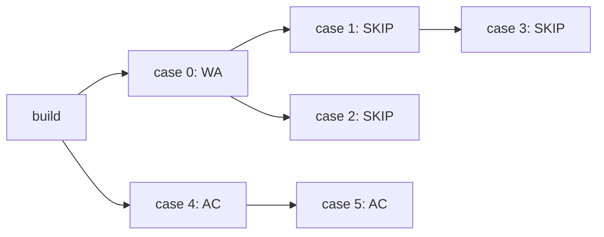

# Scaling実験：質問への回答と未達事項

2026-11-02、東京リージョンで実Engine、native C17、gVisor、AWSのqueue・artifact保存を使って実験した。対象pushは`13747d5`。[全体の入口・デモ一覧](serverless-judge.md)へ戻る。

この文書は過去のA/Bの測定条件と結果を保持する。**非ACを`job_failed`に渡す修正後の木構造デモ（C）は[別の動画・レポート](tree-demo.md)**。Aの独自な子孫SKIPは現行コードから削除した。

**VMを再利用する最大5台のpoolと、障害時の再試行は実験したが、本番受入は未達。** 必要時刻までの増設を証明できず、全台退役後の提出は結果保存まで約284〜286秒待った。起動不良VMの自動交換と請求総額の制限も未実装。

## どのソースで何を実験したか

| 実験 | 初期条件・対象 | 証拠 |
| --- | --- | --- |
| **A：広範な動作試験** | 通常1台warm、最大5台。木の打切り・先読み・再利用・VM喪失・DLQ。受信予約修正**前**。 | [観測JSON](scaling-experiment.json)・[runner](../../infra/experiments/run_scaling.py) |
| **B：受信待ちと退役の競合** | 初期5台warm、最大5台。予約済み受信を退役指示後も保護して処理する修正**後**。 | [観測JSON](drain-experiment.json)・[runner](../../infra/experiments/run_drain.py) |

pushにはAの後の修正を含む。**Aの全試験を最終ソースで再実施したわけではない。** Bの成功でAの未達判定を置き換えない。

## 1. 木構造でfail-fastできるか

**Aで確認したのは、実験用adapterが追加した条件付きの枝の打切りである。既存Engineの失敗停止と同じではない。** Aでは親caseが非ACなら子孫を実行せず、別の根から始まる枝では新規dispatchも続けた。6ケースの実験は次の木だった。

caseの実体はrun→checkの2ノード。Aの`pruned-tree`は21.216秒でWAになり、**実行済み3ケース、SKIP3ケース**だった。SKIPした子孫のrun/checkにはattempt記録がなく、VMを割り当てていない。全caseの結果を揃えてsummarizeし、SKIPを実行完了件数には足さない。

証拠はAの`joined_execution_cleanup_analysis["pruned-tree"]`。実装は[依存関係の構築](../../infra/runtime/common.py)と[子孫の打切り](../../infra/runtime/control.py)。製品の問題登録API・全言語環境との接続は対象外。

既存の[Rust Engine](../../server/traojudge-workflow/src/engine.rs)は`job_failed`を受けるとpipelineをcancelledにし、同じpipelineの後続を新しくdispatchしない。workerへ既存実行の停止命令を送る処理ではない。後続を決めるのはschedulerで、workerが後続jobを直接起動するわけでもない。AのadapterはWAを`job_completed`として渡し、独自に子孫をSKIPしたため、この失敗停止を通していなかった。**Aの結果を「失敗後は新規dispatchを止め、dispatch済みだけが継続する」という仕様の実証には使えない。** 現行adapterは非ACをcheck jobの失敗へ変換し、既存Engineへ通知する。[C](tree-demo.md)ではこの経路を確認した。

## 2. 将来の需要に間に合うようVMを確保できるか

**既知の木の先にある並列数を見て、早めに台数を要求する実装はある。必要時刻までに準備できるという実証は未達。**

予測は「未確定の親caseが全てAC」「各ノードがwall制限いっぱいかかる」と仮定し、240秒内の同時実行数の最大値を計算する。時刻ごとの需要予約や、EC2起動時間を引いて増設時刻を決めるschedulerは実装していない。新しい提出や親caseの成否も予知しない。

Aでは18秒のgateを8段通った先に5枝を置いた。

| 受付からの経過 | 初めて観測した状態 |
| --- | --- |
| 約81秒 | ASG希望台数5。 |
| 約92秒 | 所属VM5台。まだ全台が実行可能になってはいない。 |
| 約172秒 | 5台ready。**最初の広い枝の開始より0.900秒後**。 |
| 174.623秒 | 13ケース・28ノードがACとなった最後のcheckpointを永続保存。 |

観測間隔は約5秒なので、実際の準備が0.900秒遅れたと断定はできない。一方、先行準備を証明したとも言えない。Aの`checks.five_VMs_observed_ready_before_wide_tree_layer`は`false`を残している。保存済み実行区間の最大並行は5だった。

予測値は厳密な需要上界でもない。親がwall制限より早く終わると、モデル上240秒の外だった枝が先に現れる。複数runのpeakを足すことで、逆に過剰にもなり得る。[予測関数](../../infra/runtime/planning.py)はこの仮定を明示している。

短時間だけ予測3となった後、需要が1に戻っても余剰の増減が続く問題も観測した。60秒Maximumの古い高い値と、退役待ち中に現在容量を再発行する制御が関係する。Aの`controller_observations`、`safe_target_metric_minutes`、`scaling_activities_sanitized`を対応付けて読める。SQSの近似値が原因だとは断定していない。

## 3. 連続提出ではVMを再利用するか。cleanupは何を確認したか

**退役前のVMは再利用する。1 VMで同時に実行するのは1ノードだけ。** 各ノードには新しいoffline gVisor sandboxを作り、終了後にcontainerと作業領域を削除する。削除を検証・記録してから次のノードを受け取る。agent再起動時にも前のsandbox・作業領域を掃除する。

Aの`reuse-A`、`reuse-B`は同じVMで実行し、それぞれ4.756秒、10.830秒で終端を観測した。各提出の4ノードと4つのcleanup記録を照合した。試験入力はsentinelファイルを残し、子processも起動する。後続の実行に前のファイルが見えず、前のsandboxが消えていることを確認した。

これは限定した試験入力に対する証拠であり、隔離からの脱出やホスト汚染全般への証明ではない。cleanupが失敗したVMは隔離して以後実行しないが、**そのVMを自動で交換する処理はない**。起動不良・agent死亡も含め、最大5枠の一部を占有し、課金が続く未解決事項である。

## 4. VMを再利用しない場合、実用に耐えるか

**未測定。毎ノード新しいEC2を起動する方式は、現在の実装にも比較実験にもない。**

Aのcold増設は5台readyを観測するまで約172秒、Bの全台退役後の提出は結果保存まで約284〜286秒を要した。cold起動を通常10秒の経路へ毎回入れることには難しさがあるが、これらは「毎ノード使い捨てVM」のベンチマークではない。その方式が実用的だと結論するデータはない。現在の設計はwarm VMの再利用に依存する。

## 5. 待ちjobがあるとき、どうscale-inするか

未処理queue、実行中、既知の木の先読み、制御処理の待ちを見て必要台数を計算する。必要数が減ったときに余剰VMを選び、新しい受信を止めてから退役させる。自作controllerが台数を計算し、metricを発行する。実際にASGの希望台数を変更するのは、CloudFormationに宣言したalarmとExactCapacity policyである。

**ただし、退役開始後の新しい需要でそのVMを再開しない。** 遅れて届く古いscale-inが既に回収を選んでいる可能性があるため、退役を完了させて代替VMを起動する。この間、待ちjobがあっても一時的に0台へ落ち得る。

| 試験 | 退役中に到着した提出の結果 |
| --- | --- |
| A `arrival-during-drain` | 安全な代替VMでAC。終端観測まで87.110秒。 |
| B 5提出 | 初期5台を退役中に受付。全て2ケースAC、各提出の最後のcheckpoint保存まで283.763〜285.670秒。 |

Bのrunnerによる終端観測は294.793〜354.124秒だった。5提出を順番に確認した遅れを含むため、実行時間そのものやP95として扱わない。

管理用の`sleep`は、観測した待ち・実行・制御・予測仕事があれば拒否する。受付とshutdownは同一transactionではないため、運用では先に受付を止める必要がある。queue統計・需要記録には古さもあり、**継続的なbacklogがある状態での十分な試験や、最大待ち時間の保証はまだない**。

## 6. 実行中のVMを回収しない保証はあるか

**通常のASG scale-inに対して保護する設計。EC2障害や外部からの強制停止は防げない。**

VMは起動時からscale-in保護される。退役指示を永続保存した後、新しい受信を止め、予約済みの受信、実行、結果配送、cleanupを全て終えてから保護を解除する。controllerも退役token・新鮮な状態報告・実行0・受信待ちなし・実際の保護解除を確認し、それまでは台数metricを下げない。

ここでは**実行0だけでは不十分**。キューの受信待ちをしているVMは、次の瞬間に仕事を受け取れるからである。Aの後にこの競合を修正した。予約済み受信は退役指示後に返ってきても、保護したまま処理・配送・cleanupまで完了させる。

Bでは5台の受信待ち中に退役指示を出し、その最中に5提出を投入した。30ノード全て受信回数1で完了し、うちcompileの1件は`reserved_before_drain`、つまり**退役後に返った予約済みの受信から実際に実行**されていた。保存結果とcleanupも照合した。全物理VMで保存済み実行区間の重複はなく、Bの最大並行は3だった。

証拠はBの`attempts`、`receive_count_histogram`、`joined_execution_cleanup_analysis`、`saved_execution_intervals_by_VM`。安全条件は[host agent](../../infra/pool/agent.py)と[退役判定](../../infra/runtime/policy.py)にある。保存前に停止した試行や競合で負けた試行の区間は記録に含まれず、状態報告とASG保護の観測も原子的ではない。全故障下での無停止を証明したものではない。

## 7. VMが失われてもリトライできるか

**Aでは実際にVMをpoweroffして、同じrunの復旧を確認した。**

| 停止位置 | 結果と確認内容 |
| --- | --- |
| native実行中 | 228.783秒でAC。停止時にDockerが実行中だったことと、別workerでの復旧を記録。 |
| 結果保存後・通知/ACK前 | 186.684秒でAC。保存済み結果を再利用し、対象compile artifactを再生成していない。 |

NodeQueueから受信した要求は、受信後180秒間他のworkerから見えなくし、実行中は30秒ごとに延長する。VMが失われて延長が止まると再配信される。結果を保存してから完了通知・要求ACKするため、保存後の停止なら再実行せず結果を使える。保存前に停止した処理は再実行され得る。**exactly-once実行ではない。**

実行中停止のattempt記録は受信回数1、4で、2、3がなかった理由は確定していない。受信待ちと退役の競合が原因だと断定する証拠もない。復旧時間にはvisibility、EC2 health replacement、alarm周期が含まれる。Aのこの喪失試験一式を修正後ソースで再実施したわけではない。

## 8. DLQはどう処理されるか

**NodeDLQは失敗を無限retryせず、保存・終端化する経路をAで確認した。** DLQは処理できなかった要求を隔離するqueueである。

常に失敗する`poison`要求は受信1〜5回を記録し、NodeDLQへ移動した。元要求を永続保存した後、runを基盤障害`IE`として終端化した（10.395秒）。参加者のWA等の判定とは区別する。明示再判定の`operator-rejudge`は同じsubmissionの新runとなり、9.723秒でACになった。

証拠はAの`scenarios["poison"]`と`scenarios["operator-rejudge"]`、実装は[deadletter.py](../../infra/runtime/deadletter.py)。**ControlDLQと受付streamの処理枯渇からの回復は未完成。** A/B終了時に両DLQのvisible・inflight・delayedが0だったことは確認したが、それは全てのDLQ障害を回復した証拠ではない。BではpoisonやVM喪失・木の打切りを試験していない。

## 9. 最大並列数と費用の上限は

**通常のpool上限を5台、1 VM・同時1ノードに固定した。** 6つ目以降はqueueで待つ。Aの保存済み実行区間で最大5並行、Bで最大3並行を確認した。

ASG上限、起動時保護、単一AZ、置換時に先に終了してから起動する条件を宣言している。単一AZは可用性より通常の台数制約を優先した実験条件。EC2/control planeの故障や外部操作まで含む絶対的な物理台数の保証ではない。

| 稼働条件 | EC2＋public IPv4の概算 |
| --- | --- |
| `c7i.large` 1台 | $0.11735/時。 |
| 5台 | $0.58675/時（約$0.59）。 |
| 5台を730時間維持 | 約$428.33。 |

東京Linux Sharedの[EC2公開料金](https://pricing.us-east-1.amazonaws.com/offers/v1.0/aws/AmazonEC2/current/ap-northeast-1/index.csv) $0.11235/時（2026-10-01適用）と[public IPv4](https://aws.amazon.com/vpc/pricing/) $0.005/時から計算した。実際の請求額の測定ではなく、EBS・S3・ECR・Lambda・DynamoDB・SQS・logs等は含まない。

**最大5台は請求総額の上限ではない。** 金額予算による停止、受付量・保存量・保持期間・稼働期限の制限は未実装。隔離されたVMの自動交換もなく、処理と課金容量が滞留し得る。本番の破産防止を達成したとは言えない。sandboxの1時間stack削除規則は本番の費用制御の代わりにはしない。

初期の通常profileは、明示的なsleepまで1台warmを保持する。設定のidle 900秒だけで、初回から自動的に15分で0台になるわけではない。sleep後の次のwakeからは15分のwarm維持が有効になる。詳細は[policy文書](judge-pool-policy.md)へ。

## デモの有無

**現行の木構造デモ動画は[C](tree-demo.md)にある。** このA/Bの実験そのものの動画はない。[現行構成図](diagrams/judge-pool.png)は構成の説明、上記JSONは実測記録である。

[旧動画・39秒](history/2026-11-02-prototype/demos/judge-flow.mp4)は実AWSのbuild→並行run/check→summarizeと画面表示を記録しているが、**1 VM・2slotの旧構成**である。[動画の証拠JSON](history/2026-11-02-prototype/demos/judge-flow-evidence.json)も同じ条件。現行の複数VMへの増設や先読みの動画として提示しない。

旧表示の通信はJSON snapshot polling。途中の状態を飛ばすことがあり、[別のpolling観測](history/2026-11-02-prototype/demos/polling-coalescing-evidence.json)では1/3→3/3となった。SSE/NDJSONの購読契約は未実装。旧ブラウザデモのruntimeは現行ツリーから削除済み。

## 記録の読み方・再実験

| 記録の項目 | 確認すること |
| --- | --- |
| `scenarios` | 提出ごとの受付・最終状態、障害注入と受信回数。 |
| `joined_execution_cleanup_analysis` | case実行数とSKIP、保存結果・cleanup記録の対応。 |
| `saved_execution_intervals_by_VM` | 保存された実行区間の物理VM別照合。 |
| `controller_observations` | 生の需要、計算した台数、安全確認後に発行した台数の違い。 |
| `safe_target_metric_minutes` / `scaling_activities_sanitized` | metricと実際のAWS増減。 |
| `checks` / `measurement_limits` | 何を判定し、どこまでは証明していないか。該当シナリオを実施していない項目は成功試験に数えない。 |
| `teardown` | 専用stack削除後の不存在確認。 |

Aのpolicyは`lookahead`、fingerprintは`83496c57063b54b19a470ddf32b47a3dd346ca915ac3f84c2cd367a73b2a0e60`。Bは`prewarmed`、`0efdf8e7b65bac66a99a079443e97a1ed67e7ca9b241079b959477a2169f2aad`。Aにはassetの識別情報、Bには対象ソース各ファイルのSHA-256を記録している。試験後のCDK引数cleanupはtemplateを変えないことを確認し、Bにも記録した。

VM名はAWS実IDを公開しない照合用label。保存済み区間は停止前に結果を保存できなかった試行や競合で負けた結果を含まない。VM間の時刻比較はguest clockの整合を仮定する。結果保存後に停止した1ノードはcleanup記録がなく、対象VMの物理的な破棄と分けて確認した。

両試験の専用stackは削除済み。Aは11 VM、Bは10 VMについて全てterminatedを照合し、CloudFormationの不存在も再確認した。共有bootstrapは削除していない。再実験は[infra/PATTERNS.md](../../infra/PATTERNS.md)に従って専用stackをCDKから作り、表のrunnerへstack名・**新しい**report出力先を渡す。同名既存stackは先にdestroyし、成否を問わず終了後にもdestroyする。

今回の文書整理ではAWSを再実験していない。試験入力は[workloads.py](../../infra/experiments/workloads.py)に分離されたC17の入力で、製品の全言語・CLI/Nix環境やCCS全適合の実証ではない。元のpushではpolicy/host 15、case tree 1、graph 3、terminal 5、artifact 4の計28テストと型・schema・compile検査を通している。
