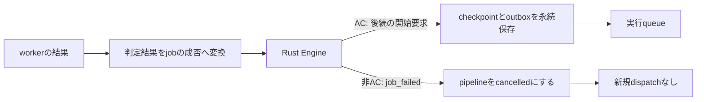

# 木構造テストケース：schedulerによるfail-fastの実演

[動画を見る（38秒・等速）](demos/tree-fail-fast.mp4) · [停止直後の画面](demos/tree-fail-fast-stopping.png) · [最終画面](demos/tree-fail-fast-poster.png) · [観測・検証JSON](demos/tree-fail-fast-evidence.json)

実AWS・実Rust Engineで、同じケース木へ2件を提出した録画。**非ACを判定jobの失敗へ変換し、既存Engineの`job_failed`で新規dispatchを止める。** workerが後続を直接呼んだり、adapterが独自に子孫を打ち切ったりするデモではない。

## 動画の見どころ

| 左：case 0がWAになる提出 | 右：全ケースACになる提出 |
| --- | --- |
| case 0のcheckがWAを返し、adapterが`job_failed`へ変換する。 | 各checkのACを`job_completed`へ変換する。 |
| Engineがpipelineをcancelledにし、新規dispatchを止める。case 1〜3だけでなく、**別の枝のcase 5も未dispatchのまま停止**する。 | Engineが依存の外れた後続をdispatchする。case 1/2、その先のcase 3、別枝のcase 5も判定する。 |
| 発行済みだったcase 4のrunは終了する。ただし**check 4は新しく発行されない**。 | 6ケースを判定し、summarizeも実行してACになる。 |
| 判定済み1/6、最終WA。summarizeも未dispatch。 | 判定済み6/6、最終AC。 |

約15秒の停止直後の画面では、左のcase 0がWA、case 4が「発行済み・結果待ち」、case 5が「未dispatch（停止）」になっている。その後、case 4だけが「run終了／check未発行」へ変わる。

黄色はschedulerが開始要求を生成した状態を表し、VM上での実行開始時刻そのものではない。未dispatchのノードはEngine内ではwaitingのまま。画面はcancelledなpipelineのwaitingを「未dispatch（停止）」と表示しており、SKIP結果や完了状態を作っていない。

## 実際の仕事の流れ

graphのノード定義は最初から登録されている。**依存が外れたjobの開始要求を出すのはscheduler**で、workerは実行結果を返す。adapterの変換はACなら`job_completed`、非ACなら`job_failed`。失敗後のdispatch停止は既存Engineの処理に任せている。



失敗を受理する前にdispatch済みだった仕事は停止しない。Engineはcancelled後の完了通知から後続を発行しない。動画ではこの区別を見せるため、長めのcase 4を用意した。summarizeも同じpipelineのノードなので、非AC側では発行されず、受理したWAがその判定runの最終結果になる。

## 表示の通信と、実行終了の観測

ブラウザはローカルの実験用adapterをJSON snapshot pollingする。応答後800msで次を取得し、実AWSの受付・状態取得APIの応答を表示する。途中revisionを全て表示する保証はない。

cancelled後はEngineが遅い完了通知を無視するため、case 4の実行終了だけは、adapterが永続保存された外部実行結果を読み取って表示する。**schedulerの状態を完了へ書き換えたり、新しいjobを発行したりはしない。** この観測のため、Engine上ではrun-4がrunningのままでも画面に「run終了」と表示される。実験用の観測ビューであり、製品APIの公開契約ではない。SSE/NDJSONは使っていない。

## 証拠と測定条件

[検証JSON](demos/tree-fail-fast-evidence.json)の`scenarios`にはEngineの状態、開始要求を送ったノード名、実行結果、attempt、cleanupの対応を保存した。

- 非AC側でdispatch・実行されたのは`compile`、`run-0`、`run-4`、`check-0`の4ノード。`check-0`はEngine上でfailed。後続とsummarizeにはattemptがない。
- 全AC側は14ノードを実行し、6ケースとsummarizeが完了した。
- 保存された実行区間を物理VMごとに照合し、同じVM内で重複していないことと、各実行のcleanupを確認した。

今回の保存済み区間の最大並行は4。5台をwarmにした条件と、実際に同時実行した数を区別している。関連する29テスト（case tree 2、terminal 5、graph 3、pool/host 15、artifact 4）も通した。

録画は2026-11-02、東京リージョンで行い、開始前に5台のwarm VMが保護付き・同時1実行・仕事なしであることを確認した。policyは既存の`prewarmed`、最大5台。ケースの意図的な待ち時間は2.5秒、2秒、2秒、1.5秒、14秒、2.5秒で、[実験入力](../../infra/experiments/workloads.py)に分離している。速度変更・カットなし。**通常10秒目標やcold増設の速さを測る試験ではない。** 保存前に失われた試行等を含む全故障下の保証でもない。

以前の実験Aは「WAを成功通知として扱い、子孫だけを独自にSKIPする」別の動作だった。今回はその処理を削除した。[A/Bの記録](scaling-experiment.md)は過去の条件を保持し、今回の証拠には流用していない。

## 再実行するコード

入力は[workloads.py](../../infra/experiments/workloads.py)、表示は[server.py](../../infra/experiments/tree_demo/server.py)と[index.html](../../infra/experiments/tree_demo/index.html)、録画は[record.py](../../infra/experiments/tree_demo/record.py)、実行との照合・drainは[audit.py](../../infra/experiments/tree_demo/audit.py)。[infra/PATTERNS.md](../../infra/PATTERNS.md)に従って専用stackを作り、`prewarmed` profileを選ぶ。5台readyを確認してからserver、record、auditの順に実行する。

server/auditにはboto3、recordにはPlaywright・Chromium・録画用ffmpegが必要。リポジトリのルートから、serverを動かすshellとは別のshellでrecord、auditを実行する。新しい出力先を選び、既存の観測記録を上書きしない。

```sh
python infra/experiments/tree_demo/server.py --stack '<branch>-TreeDemo'
# 別のshellで録画し、その後に照合・drain
python infra/experiments/tree_demo/record.py --output work/new-tree-recording
python infra/experiments/tree_demo/audit.py --stack '<branch>-TreeDemo' --browser work/tree-demo-browser.json --output work/new-tree-evidence.json
```

撤去は**controllerのsleepでdrainし、ASGの希望0・所属VM0を確認してからCDK destroy**する。未実行の先行`codex-serverless-judge-TreeDemo` stackを直接destroyした際は保護付き5台が削除を妨げ、VPC接続の削除もタイムアウトした。受付削除・提出なし・空queueを確認した上で撤去に限って保護を手動解除し、CloudFormationで削除を再試行した。これは通常のruntime scalingが成功した証拠には数えない。録画用stackはdrain後に削除し、撤去結果を検証JSONの`teardown`に残した。
